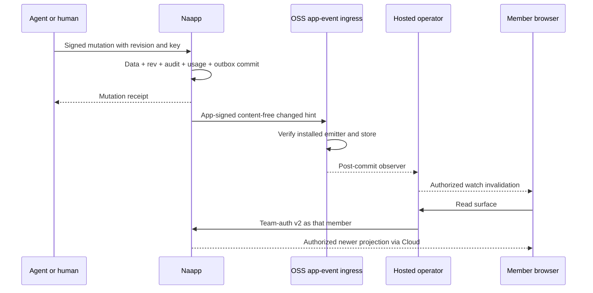

# Agent-built pages and the generic naapp layer

Status: **D1 proposal, aweb-acgg.1, awaiting independent review, Athena and Juan.**
This is a design, not a claim that these interfaces ship. Secrets is the second
design consumer. The shared runtime pieces both need (verifier, approval
primitive, WebAuthn verifier) are built in `aweb_naapp` under the secrets
lane's own tasks, which D1 checks for fit; the joint assurance policy remains
a recommendation to Juan. Juan's 2026-10-19
approved direction and its six binding decisions govern it. No implementation,
production probes or customer writes are part of D1. Scope changes below are
recommendations to Juan. First delivery includes outsider action links, subject
to Athena's ruling; it includes export, deletion, backup and retention.

In this design, Cloud means aweb's hosted operator. Every requirement placed on
it is stated generically, so it holds for any hosted operator or custodial
deployment. OSS defines portable formats, verification and generic embedding
seams; the hosted operator owns hosted custody, the dashboard, wake delivery,
hosted MCP and operations, and documents its implementation separately. No
deployment hostname, internal secret or hosted account schema governs an OSS
contract. The shared renderer belongs in `packages/`, usable by any naapp.

## Summary for Juan

Folio grows into a typed page store: immutable layout/document versions, mutable
collections and widget state with revisions and audit. Agents supply data and
proposals; people edit local data immediately or submit durable requests to
agents. An approval card renders the same aweb task as “waiting on you”. An
external effect requires approval of that exact proposal and an enforcing
adapter; the joint recommendation adds app-origin passkey assurance for external
or irreversible actions, subject to Juan's decision. A button label alone cannot
guarantee approval.

Cloud reads and invokes manifest-declared tools as the actual member. Agents
use their own keys or their own hosted custody. A verified, post-commit app-event
observer wakes browsers; every browser then re-reads through Cloud as its member.
Outsider links use a separate, explicitly limited capability at the naapp.
Usage originates at the naapp, so direct CLI traffic is counted too. A second
fixture app gets tools and a surface by manifest alone.

Approval asks: accept the task/approval transaction extensions, manifest v2
rollout and data-lifecycle baseline; Athena rules on link authority and rendering.
Nactiva integration, PMS choice and customer writes require separate approval.

## 1. Evidence and governing model

Source baseline **A = aweb origin/main b423415a92bf1a43d023e0dddc962036266d831a**.
Every `A path:line` below refers to that commit, not a moving branch.

| Observation at A | Evidence |
| --- | --- |
| Team-auth v2 binds one request to its member certificate; the relying app applies permissions. Replay within the skew window remains possible. | `docs/team-auth-envelope-v2.md:3`, `:40`, `:95`; `naapp/folio/src/folio/auth.py:304`–`:367` |
| Mixed custody works without transferring controller authority to the app. | `docs/product-authority-sot.md:104`–`:130` |
| v1 manifests are strict and versioned; parameters and canonical request mapping are explicit. | `docs/app-manifest.md:46`, `:106`, `:179`, `:281`; `cli/go/internal/appmanifest/interpret.go:28`, `:53`, `:196` |
| Install currently authenticates a member, records the supplied digest and scopes, and does not independently fetch bytes or require an admin. | `server/src/aweb/routes/apps.py:104`–`:132`; `docs/app-manifest.md:100`–`:104`; `docs/app-events.md:61`–`:68` |
| Folio verifies membership but has no install/scope check in that authentication path. | `naapp/folio/src/folio/auth.py:304`–`:367` |
| App events are metadata wakes; no durable cursor/ack, five-minute lookback, 300-second connection. | `docs/app-events.md:16`–`:35`; polling interval `server/src/aweb/routes/events.py:49`–`:53` |
| App-event ingress verifies, inserts and returns; no embedding observer yet. | `server/src/aweb/routes/events.py:589`–`:608` |
| Folio append and append-template emit; create returns without emitting there. Emit errors are swallowed. | `naapp/folio/src/folio/api.py:252`–`:259`, `:276`–`:314`; `naapp/folio/src/folio/event_emit.py:73`–`:106` |
| Existing present links pin read-only versions; editable links select latest and require unrevoked/unexpired capability. | `naapp/folio/src/folio/repository.py:327`–`:445`, `:481`–`:503` |
| Folio enforces document/version caps today. | `naapp/folio/src/folio/repository.py:23`–`:43`, `:105`–`:157` |
| Task creation is member-authenticated, strict, assigned by alias, and fires mutation hooks. Structured action metadata/idempotent creation are new work. | `server/src/aweb/coordination/routes/tasks.py:33`–`:43`, `:98`–`:133`; `server/src/aweb/coordination/tasks_service.py:181`–`:291` |
| Health is host-published evidence, with explicit fallback, not inferred runtime presence. | `docs/agent-health.md:19`–`:57` |
| Shared naapp-lib currently exports documentation/chrome helpers, while Folio and Library have separate member-auth implementations. | `naapp-lib/README.md:3`–`:17`; `naapp-lib/src/aweb_naapp/__init__.py:34`–`:56`; `naapp/folio/src/folio/auth.py:304`–`:367`; `naapp/library/src/library/auth.py:368`–`:431` |
| Only one experimental in-process mutation callback ships; a named hook registry/catalog does not. | `docs/aw-hooks-sot.md:17`–`:19`, `:42`–`:63`; `server/src/aweb/hooks.py:12`–`:27` |
| Current Folio present tokens are stored directly, without a single-use/request-hash contract. | `naapp/folio/src/folio/repository.py:362`–`:380`; `naapp/folio/src/folio/migrations/001_initial.sql:70`–`:82` |
| Folio's old doctrine explicitly excludes dashboard write paths. | `naapp/folio/docs/agent-first.md:109` |

A hosted operator or custodial deployment must meet these requirements, which
the rest of this design relies on:

- It signs a member's requests as that actual member, with that member's
  certificate. It never reuses a credential selection that would pick the team
  controller or another agent for a member call.
- A dashboard user without a registered member certificate takes an explicit
  provisioning or refusal path. Imported BYOT members are never provisioned
  silently.
- Browser wakes carry no content. On a wake the host reauthorizes the session
  and re-reads as the member, and a periodic safety reconciliation covers lost
  wakes.
- Human requests and answers go through the shared task answer flow (§4). No
  mounted route lets a human create arbitrary tasks around it.
- Hosted MCP tool lists come from installed manifests per actor (§5). Hosted
  transport counters never replace app-originated usage (§8).

The assignment supplies a first-hand rental workflow through the coordinator,
known through 14 October and not yet customer-confirmed. The coordinator's
2026-10-19 operator report resolves the stale standalone/monorepo question:
production builds the monorepo `naapp/folio`. This is relayed operator evidence,
not a D1 live verification; deployment details belong in the operator's records.
F1 now confirms reproducibility/provenance rather than assuming a source move.

**Authority, before mechanisms.** AWID establishes current team authority and
member certificates. Fully Hosted custody may hold member keys and the hosted
controller; these are distinct powers. BYOT's controller remains with its owner,
even when some members use hosted custody. A domain string or a working Cloud
credential establishes neither controller authority nor membership. Pages create
app-local resources; they do not create, join, recover or reassign identities.
A missing dashboard member certificate is an identity provisioning/refusal path,
never permission to sign as a controller or another agent. Existing certified
BYOT and self-custodial members use the same verifier. Resident grant tools remain
bounded by the resident's approved app snapshot (`A docs/naapp-access.md:41`–`:78`).

A member authorizes a request with team-auth v2. The naapp verifies actual
external target/query, audience, exact body hash, member/certificate binding,
current team key and revocation, then installation, scopes and resource/action
policy. Expired authority caches fail closed. A valid signature proves request
authorization, not permission for every action. Link possession proves only the
specific capability, never a claimed name or team membership. App emit keys prove
app metadata delivery only, never a human decision or authority to run tasks.

### Shared naapp-lib verifier

The in-repo `naapp-lib/` (package `aweb_naapp`) is **the** shared naapp runtime
home, per Juan's 2026-10-19 direction: the team-auth verifier, the approval
primitive and capability links live there, used by pages, secrets and every
other naapp. No new package is created and no app keeps a copied `auth.py`.
Keep the existing lightweight docs helpers usable without runtime-auth
dependencies; package the runtime pieces behind an explicit packaging seam. No
runtime verifier ships in that package at A (exports cited above).

Adopting it has a foundation prerequisite: Folio and Library still depend on the
archived `awebai/aweb-naapp` git repository at rev `4dbeb4bc`
(`A naapp/folio/pyproject.toml:52`, `A naapp/library/pyproject.toml:56`), not on
the in-repo library. F0 (aweb-abre, superseding aweb-aauv.3) moves them to
in-repo path sources before any app adopts shared runtime code (§11).

Build ownership is split to avoid building twice. The secrets lane (epic
aweb-acgh) builds the verifier as B1 (aweb-acgh.3) and the approval primitive
plus app-local WebAuthn verifier as B2/B3 (aweb-acgh.4), all in `aweb_naapp`;
the D1 lead checks each against this design. Pages consumes them and does not
build its own. B1 preserves today's acceptance exactly and adds scope and
policy enforcement; the global current-key profile below is a separate
follow-up change, not part of B1. B1's principal keeps `member_did_aw` from the
certificate, scoped to its team. The team controller's certificate signature
makes it a team-asserted binding, sound for grants inside that team. It is not
registry-verified as the did:aw's current key until B1b.

The verifier authenticates exact team-auth v2 bytes/target/audience, signer and
certificate binding, current team key, certificate revocation and bounded
freshness; then applies installation generation/scopes and calls app-owned
resource/field/action policy. It returns verified identity/evidence, not a
blanket authorization. Anonymous capability and app-purpose verifiers remain
separate entry points. Cloud custody selection never moves into this library.
Reuse public AWID/signing primitives and shared vectors rather than reimplementing
crypto in each app. Expired or incomplete authority fails closed with a distinct
unavailable result, while a valid neighboring identity remains usable.

The verifier takes an explicit grant source; it never assumes a grant from a
valid signature. It maps the actual method and raw path to a tool declared in
the installed, pinned manifest, refuses member-authenticated routes that no
declared tool maps, and requires that tool's scopes within a fresh grant.
Before adoption, each app inventories the member-authenticated routes its
released clients call, so this mapping does not silently refuse an existing
caller. A stale or unavailable grant is `503 authority_unavailable` with no
fallback; a fresh grant lacking the scope is `403 scope_denied`; app policy
refusal is `403 action_denied`. The grant result carries `installation_id` and
`generation` fields from the start. A source that cannot supply them, such as
the registry at A, which is keyed only by team and app
(`A server/src/aweb/migrations/aweb/008_app_registry_grants.sql:42`–`:60`),
reports them as absent. Operations that bind them (task authorization, hook
activation, the admission fence) refuse rather than synthesizing a generation
from the digest or app ID.

For global identity authorization, propose an explicit versioned naapp verifier
profile: when the verified certificate carries `member_did_aw`, resolve its
current key at the trusted registry for that authority context and require it
to equal the actual signer/certificate key. Cache keys include registry origin
and stable DID, with at most 60-second reuse and no expired fallback. Local
`did:key`-only members need no global row or address and remain valid. The
current-key authority is `A docs/awid-sot.md:310`, `:447`–`:449`; a comparable
identity-auth check is `A server/src/aweb/identity_auth_deps.py:90`–`:113`.
Neither a caller-supplied registry URL nor a route/domain string substitutes for
that authority. This is an explicit relying-app profile addition, not an
assertion that the present team-auth v2 verifier list already requires a separate
global resolution (`A docs/team-auth-envelope-v2.md:40`–`:70`). New page/secrets
operations adopt it after review; changing existing Folio/Library acceptance
requires a named compatibility rollout, current certificates/reissue path and
Juan's explicit identity-path approval recorded in the implementation commit.
Historical signature evidence remains evidence, not permission for a new call.

Team-auth proves neither who holds a key (custody mode), a separate OAuth human
principal, nor that a request originated in a human surface. Its optional
`operation` field is informational (`A docs/team-auth-envelope-v2.md:34`–`:38`),
and mixed custody intentionally shares membership verification (`A
docs/product-authority-sot.md:114`–`:130`). Any credential policy requiring
those extra facts needs a separately verified attestation/delegation contract
(for hosted custody, a Cloud-produced signed attestation is a legitimate candidate);
unknown proof refuses that policy, never guesses from a header or hostname.
Ordinary page/tool operations do not gain a new custody-proof prerequisite.

## 2. Portable page format

Draft artifacts: [JSON Schema](agent-pages/page.schema.json),
[wire sketches](agent-pages/contracts.md), and [examples](agent-pages/examples/).
They are review material under `docs/design/`,
not frozen conformance vectors. C1 promotes reviewed contracts next to
`docs/app-manifest.md`, schemas and vectors with deliberate version ownership.

A `page_format: "aweb.page/1"` response has `page_id`, `locale`, `title`, `rev`,
`layout_version`, owner identity, visibility policy reference, widget tree,
collection definitions, a bounded authorized data snapshot, widget state and
action definitions. IDs are opaque within `(team, app, page)`, never names or
capabilities. Layout version is immutable; every successful local transaction
increments a monotonic page `rev`, even if it changes only state, action progress,
ACL or deletion. Each record has its own `rev`. Revisions are decimal integers
bounded to JavaScript's safe integer range; the draft schema enforces that
range on every revision and version field.
Deletion preserves a tombstone revision for authorized sync. Signed numeric
values use safe integers; fractional quantities use schema-declared decimal
strings until C3 freezes any wider numeric canonicalization. A `number` form
field emits the schema's integer or decimal-string type, independent of locale.
Bound the entire response and validation work (initial 10 MiB snapshot ceiling,
widget nesting depth at most 8 and at most 2,000 widgets per page). The host
checks depth and widget count before running schema validation, so a hostile
tree cannot exhaust the validator; lint reports the same limits;
large collections paginate and legacy Markdown may use bounded text chunks.

Three independently writable parts:

- **Layout**: stable widget IDs, semantic order, bounded stack/grid containers,
  declarative props and bindings. Layout edits append an immutable version.
- **Data**: named collections, each with an inline JSON Schema, record IDs,
  record revisions and provenance. A schema version cannot reinterpret old data;
  migration validates every retained record before activation.
- **Widget state**: a map keyed by stable widget ID, holding allowlisted display
  overrides such as message, progress or busy. It cannot change binding, action,
  policy, links, task reference or input schema. It is shared durable state;
  unsent input drafts, focus and scroll are browser-local.

The initial vocabulary is complete in this delivery:

| Widget | Typed contract and behavior |
| --- | --- |
| `text`, `heading` | Markdown without raw HTML; heading level 1–6; escaped text values. |
| `stat`, `status_badge` | Typed bound value or literal with label; finite display tone; never raw CSS. |
| `table` | Bound collection, explicit field columns, stable record row keys, sort/filter, pagination and named row actions. |
| `cards`, `list` | Bound collection with field mappings; stable record keys and named actions. |
| `form` | Labeled `text`, `number`, `date`, `select`, `checkbox`, `file` fields; required/description/options, inline validation and named submit action. No password fields. |
| `button` | Label and named action reference; confirmation for consequential actions. |
| `decision_card` | Reference to an acah.4 task and exact proposal record/revision, the canonical `proposal_sha256`, the external operation (kind, destination and a summary), the source-system version, `expires_at`, options, a recommendation that must be one of the options, and an answer action that must be `answer`-kind (lint checks both). Task answer/status is authoritative. |
| `chart` | Bound numeric series and field mappings, finite bar/line/pie kinds, textual/table alternative; no expression engine. |
| `file_drop` | Named upload action, allowed MIME types and byte bound; attachment IDs rather than user URLs. |
| `image`, `video` | Folio asset ID, alt text/caption, controlled playback; no agent iframe/HTML. |
| `activity_timeline` | Bound authorized audit/activity projection; entries escape actor and text. |
| `agent_presence` | Subject identity plus honest-health rendering and report age; never a guessed green dot. |
| `stack`, `grid` | Semantic order; bounded columns, tokens from renderer catalog; collapse on phone width. |
| `link_out` (proposed addition) | Opens the installed app's own pinned origin only, shows the normalized domain, opens a new top-level context with no opener or referrer, and never carries a token or capability in the URL. For app-owned ceremonies and consoles, such as secrets' owner console. |

Bindings use collection ID, an `all` list of `{field, op, value}` predicates
(`eq`, `ne`, `lt`, `lte`, `gt`, `gte`, `in`), an ordered sort list and bounded
limit/cursor. Fields are literal schema property names, not executable paths.
No SQL, JavaScript, templating expressions, arbitrary regular expressions or
network calls. The naapp validates query fields/types, intersects row/field ACLs
**before** filtering, sorting, counts or aggregates, and returns only authorized
rows. Cursors bind actor, policy revision and query; they do not grant access.
One projection per widget avoids leaking a broader collection in the browser.
The draft full-page examples represent small authorized snapshots, not a mandate
to transfer all data. Large pages use independently paginated widget projections
with one snapshot revision; a changed revision causes restart, not mixed data.

Unknown widget types render an inert, localized placeholder using a bounded
plain-text fallback, ignoring its props (accepted for forward compatibility,
bounded to 32 properties and never read), with no children, network or
actions. Unknown major
page format refuses with a safe whole-page fallback. Known invalid widgets
produce validation errors rather than silently turning into unknown widgets.
Unknown fields in known contract objects are rejected. Authors can validate
future catalogs explicitly; the unknown branch in the draft schema exists for
older readers, not to enable arbitrary widget implementations. Widget IDs are
unique across the entire tree; action/collection/field references must resolve.
The agent lint tool reports JSON pointer errors plus an accessible text rendering
including labels, values, policy-disabled actions and unavailable widgets.

### Prior art and chosen tradeoffs

Sources consulted 2026-10-19 (comparisons, not imported normative schemas):

| Source | Take | Boundary |
| --- | --- | --- |
| [Slack Block Kit](https://docs.slack.dev/block-kit/) | Fixed blocks, explicit action IDs and accessible text fallbacks. | A page needs persistent typed records and conflict handling beyond a message layout. |
| [Teams Adaptive Cards](https://learn.microsoft.com/en-us/adaptive-cards/schema-explorer/adaptive-card) | Explicit format version, host rendering and fallback. | Keep our own catalog and adapter; no promise of lossless Teams rendering. |
| [Google A2UI](https://a2ui.org/concepts/overview/) | Separate component structure from bound state; declarative updates. | Use a small fixed catalog and naapp-owned durable snapshots rather than importing its transport/version churn. |
| [MCP Apps draft](https://github.com/modelcontextprotocol/ext-apps/blob/main/specification/draft/apps.mdx) | Host-mediated tool/UI boundary and explicit capability negotiation. | Its sandboxed HTML UI model is the later own-origin frame lane. Initial pages contain no app HTML or JS. |

Teams/Telegram adapters later render supported subsets and retain fallback plus
authorized action references. Unsupported decisions open the canonical page;
adapters must not broaden permissions or execute on a message preview.

## 3. Data transactions, audit and customer ownership

Collections declare `mode: "owned" | "synced"`. Owned records are page data.
Synced records identify source type, opaque external ID/version, sync time and
freshness; the PMS remains authoritative for bookings/listings/messages in the
rental example. Local annotations and proposals live in owned collections with
references to synced records. External rows cannot be edited as though a local
write had already changed the PMS. A “change price” action is a direct edit for
owned draft data, an approval-gated intent for a PMS price.

All mutations require an application idempotency key and expected page revision;
record changes additionally require expected record revisions. The transaction
locks the page, checks expected revisions and policy, validates schema and
allowed fields, writes records/state/action progress, audit, usage and outbox,
then increments page `rev` once. JSON Patch is restricted to declared record
fields and display state; it cannot patch ACL, task/approval metadata, revision,
provenance or collection schema through a generic edit. Schema/layout/ACL changes
have separate authorized operations. No implicit last-write-wins. Conflict
returns `409 revision_conflict` with current authorized revision; the client
re-reads and asks the human to reapply their edit. Omitted preconditions return
`428 precondition_required`, schema errors `422` with JSON pointers.

Optimistic concurrency is scoped to a page initially. It is simpler to explain
and makes `action.resolve` one local atomic transaction; independent record
preconditions prevent accidentally overwriting a different row. If contention
later justifies collection clocks, that is a new contract with the same conflict
guarantees. Request keys are `(installation_id, team_id, principal_id, key)`;
store canonical request hash and receipt. Same key/same bytes returns the first
receipt without another mutation, even when the supplied revision is now old.
Same key/different request returns `409 idempotency_conflict`. Recheck current
read permission before returning a historical receipt. Keep key tombstones for
the resource lifetime plus the configured deletion/retry horizon; expired keys
return `410 idempotency_expired`, never silently execute again.

Audit records transaction ID, old/new revisions, signer DID/certificate,
verified member/stable identity, origin kind, server time, action/task/approval
IDs and changed fields; restricted before/after values stay under data ACL and
retention policy. Store request evidence for approvals while needed, separately
from public activity text. “Updated by bond, just now” comes from this verified
record, not agent-supplied display text. Link events say “anonymous, via link X”
with capability ID and optional link-local key, never a claimed person.

### Export, deletion, backup and retention from first delivery

A team admin can export the installation; a page owner exports their authorized
page. The archive contains a versioned manifest, layout/document history,
schemas/records/state/provenance, tasks/answers accessible to the requester,
audit with policy redactions, actions and approval records, and assets/checksums.
It excludes signing keys, bearer links and other actors' private data. Include
stable IDs, revision cut, source mappings, format versions and a machine-readable
list of external task/artifact references the exporter could not retrieve. A
portable restore/import validates ACL mappings and all schemas before activation;
it does not revive capabilities, approvals or pending external effects.

Deletion is a durable job with `requested`, `access_revoked`, `purging`,
`complete` states and a receipt of coverage and remaining retention deadline.
Revoke links and access immediately, cancel undispatched requests, invalidate
approvals, remove live data/assets/derived caches/search projections, and emit a
tombstone wake. Already dispatched external work must be reconciled and reported;
page deletion cannot pretend to delete a PMS booking. Explicitly identify retained
team task records and minimal non-content tombstones; coordinate their erasure
through the task owner instead of claiming a page delete erased another app.
Legal retention exceptions, if any, must be disclosed in the receipt.

Proposed initial operator policy, **for Juan approval**, is encrypted daily
backups, recovery point at most 24 hours, tested restore, backup expiry within
30 days, primary content purge within 7 days, audit content retention 90 days
unless the team chooses less. These are retention/recovery policies, not delivery
estimates. Before collecting business data, the operator publishes the actual
policy/version and restore objective and proves it meets or improves this
baseline. Do not silently ship unspecified retention. Deletion tombstones live
outside restorable content and are reapplied before any restored database is
served; backup expiry and asset-provider deletion are included in completion
receipts. Content-free usage totals may outlive content under a disclosed policy.
Deletion overrides routine audit-content retention unless a disclosed legal
obligation requires retention; preserve minimal non-content receipts instead.
Cloud owns backup operation; OSS defines the receipts and export/deletion hooks.

## 4. Actions, tasks and approval

The three action kinds are `edit`, `intent`, `answer`. Definitions contain an ID,
label, input schema, server policy reference and a target agent/role where
applicable. Layout is a view of these definitions, never the policy authority.
A role target resolves against the current app/team role map to one stable
identity at acceptance, then is frozen and audited. Ambiguous/missing role is
`422 target_unresolved`; no silent reassignment. Default is the page owner's
agent identity. An authorized retarget is a separate audited operation.

`edit` performs only declared local data/state changes, immediately without an
LLM. It still requires schema, field policy, revisions and idempotency.
`intent` asks an agent for work and returns an action receipt before the agent
runs. `answer` answers the existing task assigned to that human, tied to the
exact proposal; it is not a new parallel decision request.

### One request primitive in both directions

**Choose aweb tasks.** Juan's acah.4 ruling of 2026-10-15 makes tasks the primitive
for requests. Decision cards render the actual assigned task; dashboard “waiting
on you”, agent page and naapp page all answer the same task. Human-to-agent
intents also use tasks, assigned to the resolved agent. Tasks provide durable
ownership, an inspectable backlog, comments and closure across runtimes. Mail
can carry the existing answer notification (`Re: <ref> <title>`), but does not
create another request state. App events wake only; they are never the carrier.
The older mail recommendation in `A docs/app-events.md:34` remains correct for
ordinary app requests without task integration. This proposal adds a task-backed
alternative, not a claim that existing event durability improved.

Task metadata is team-visible today. Use generic titles, opaque page/action
references and no guest message, booking details, capability or private proposal
in title/comment/mail. The agent re-reads using its own certificate and page ACL;
assignment does not grant page access. A restricted page can leak its existence
through a task reference: disclose that boundary and use unguessable references.
Until task visibility changes under its own owner, do not promise a private task
or copy confidential answer values into a team comment. The acah.4 decision about
team-visible answers remains with Juan/Athena; pages do not decide it by accident.

Two stores cannot share a transaction. Required new generic task integration:

1. Member signs the naapp intent or decision proposal creation. The naapp commits
   its action journal plus task-delivery outbox and returns `202`, `delivery:
   "pending"`; the UI says “saved; sending”, not “sent to bond”.
2. Every member submission includes a nested, purpose-bound `task_authorization`
   signed by that member (Cloud custody or self-custodial CLI). It authorizes
   exactly one minimal task creation at the selected task origin. The naapp
   persists it with the journal/outbox. Public app-request task ingress verifies
   this authorization and a separately signed app transport credential; it
   records the original member and transporting app separately. No member key
   is held by the naapp and no existing HTTP signature is replayed elsewhere.
3. The task service adds optional typed `app_request` metadata, a deterministic
   `external_request_id` and create/read deduplication scoped to team, app,
   installation and originating principal. Existing task-create shapes remain
   accepted. A retry returning the same task is safe after response loss. A
   different body for that key conflicts. The naapp records the verified task
   receipt; only then `delivery: "queued"` means “sent to bond”.
4. Durable task state/answer is authoritative for the request. Naapp action state
   is execution/projection state, synchronized from authenticated task changes
   and periodically reconciled on reads/recovery. Missed wakes cannot strand it.
   Agent pickup requires explicit assigned-agent acceptance/claim receipt.
5. The same integration exposes idempotent answer and conditional transition
   keyed by task revision, expected assignee, proposal revision/hash and answer
   key. Plain comment/close is still valid coordination, **not** executable
   business approval. The existing acah.4 answer route calls this shared flow;
   a page cannot approve by bypassing it.

The naapp owns this delivery outbox, so a dead browser or CLI cannot strand a
member-authorized accepted request. Task authorization uses a new domain-separated
signed artifact, not a team-auth envelope with a different target. Its canonical
payload binds `v`, `type: "aweb.app-task-authorization"`, task `aud`, `app_origin`,
`team_id`, `app_id`, `installation_id`, install generation, `external_request_id`,
actor DID/certificate ID, target stable identity, exact minimal task-body digest,
action ID, proposal revision/hash, `issued_at`, `expires_at` and nonce. Store the
signature and certificate alongside it. The task service verifies signature,
certificate binding/current revocation, audience, active installation generation,
`requests:create` scope, exact body hash, target and validity before dedup/commit.
Original actor is not supplied through a trusted-header shortcut. Replays return
the existing task only to an authorized caller; changed body conflicts. Expired
or revoked authority before first delivery leaves a visible pending request
requiring renewal; it is never silently replaced by another actor.

App transport uses the installed app's registered key, but a **new purpose**
`auth: "app-request"` and `Authorization: AWEB-App-Request DIDKey …`, binding the
same HTTP method/external target/audience/team/app/install generation/body hash/
timestamp/kid as the request. Existing `AWEB-App` event signatures cannot pass
this verifier. New task create, answer receipts and their vectors are C2, subject
to Athena and Juan approval; they do not exist at A. Ordinary direct team-auth
task creation remains accepted. This chooses one interoperable recovery path,
not separate browser and CLI workarounds.

An outsider has no member authorization. Link actions commit an anonymous journal
entry and notify a configured sponsoring agent; its recovery work lists pending
entries even after lost wakes. That agent explicitly creates a task as itself,
with link-origin evidence, after policy checks. Until that happens the UI says
“saved; awaiting routing”, not “sent”. The sponsor's task grants no external
approval. A link creator must configure a sponsor/recovery path before an intent
link can activate; the link holder never inherits the sponsor's key.

### Lifecycle and atomic resolution

Request projection: `saved/sending → sent/queued → picked_up → done | failed`.
Cancellation and uncertain external outcome are explicit substates with reasons;
health is a separate field, never a transition trigger. A task marked
`in_progress` is only picked up when the assigned agent's acceptance is recorded.
A bare team-member closure does not establish successful external execution.
A failed action retains a one-line safe result and retry policy; a new business
attempt needs a new key, while transport retries keep the old key.

`action.resolve(id, result, patches)` is signed by the fixed assigned executor,
requires expected action/page/record revisions and any approval, and atomically
writes execution status, local data changes, audit, usage and event/task-mirror
outbox in **one naapp revision**. A conflicting patch means no result or partial
patch is committed. A task mirror can be delayed; show “result saved; task sync
pending” and reconcile. External PMS writes and task closure are outside this
transaction; no distributed exactly-once claim. External adapters use stable
operation IDs, provider idempotency if supported, and status lookup/manual
reconciliation after an ambiguous response. Never blindly retry an uncertain
booking or guest message send.

Offline copy comes from the signed/fresh acah honest-health status and its age:
“bond offline since 10:02; request queued” only if those facts are known.
Expired/absent health says “status unavailable; request queued”. Mail read,
stream presentation, presence and accepted task are distinct from execution
(`A docs/agent-health.md:19`–`:57`).

### Exact approval and enforcement boundary

For an agent proposal, create an acah.4 task assigned to the named authorized
human. The decision card binds task ID/revision, proposal record ID/revision,
canonical proposal digest, allowed choice, scope of external operation, destination,
source-system version and expiry. Re-editing a proposed price/reply produces a
new proposal hash and requires a fresh answer. Recommendation is advisory.

The naapp verifies the member-signed answer request and the conditional task
answer receipt. It stores a scoped approval record including request digest,
signer/certificate and decision revision, bound to that task answer. No approval
becomes executable while task synchronization is pending. Rejection closes the
request without execution authority. Approve-and-edit creates a new immutable
proposal and records the human's approval of its resulting bytes atomically in
the answer workflow. Concurrent answers yield one accepted task answer; another
view re-reads it. A later revocation wins before dispatch; after external dispatch
it becomes a reconciliation/compensation request, not retroactive prevention.

The naapp exposes an authenticated consume/dispatch operation to the authorized
external adapter, atomically checking current approval, task binding, installation,
policy and source preconditions and recording one stable operation ID. Retries
return that operation's status. The adapter must enforce that receipt before
changing PMS state or sending a guest message; it records provider receipt and
feeds resolution back. Agents are untrusted planners of these effects. If the
same agent holds unconstrained PMS credentials, a page cannot mechanically
prevent it from bypassing approval: before the rental pilot, move effects behind
an enforcing adapter or constrain its credentials. This is a first-case dependency,
not a decision to defer the approval guarantee.

### Joint approval primitive: pages and secrets

**Bounded joint outcome with secrets, for Juan's decision:** one primitive in
`naapp-lib`, with records owned and persisted by each naapp, covers both. The
request hash is frozen when shown to the human. It covers canonical operation,
external destination, constraints, source version, executor and policy version;
an optional bundle covers the entire ordered set of N proposals under one hash.
Changing any covered value requires a new approval. Public identifiers are
references, never reusable approval/execute capabilities.

Shared record: `approval_id`, `request_sha256`, immutable request reference,
`policy_ref`/version, `requested_by`, `approver_subject`/type, constrained
`authenticator`, `auth_evidence_ref`, presentation kind/reference,
`task_answer_ref` when presented as a task, state, policy-set `expires_at`,
`revoked_at`, and `consumed_operation_id`. App policy validates minimum assurance
from verified evidence; a caller cannot choose it by setting a string.

The **new joint assurance recommendation**, not an existing Juan decision, is
`passkey` for external/irreversible effects and every secrets approval;
`member_session` is permitted only for internal reversible decisions under app
policy. The reason is what each proves to the app. A passkey assertion at the
app's own origin proves a fresh, user-verified human gesture bound to this exact
request. A member-session signature proves that the member's key, which hosted
custody may hold, authorized the request, but not that a person acted just
then. The naapp therefore cannot tell a hosted human from that member's own
hosted agent: both sign as the same custodial member. A `member_session`
approval is safe only because the custodian honors `invocation_contexts`. Answer
and approve tools are surface-only (the surface's `answer_tool`), L2 never
lists or calls them, and the member-approval endpoint is never an MCP tool
(§5). The approver≠requester refusal below is an additional check, not a
substitute: it does not stop a member's own agent answering a task another
principal raised. The naapp also refuses a
`member_session` approval when the approver principal equals the requesting
principal, unless app policy explicitly allows it for an internal reversible
action. Passkey remains the bar for external or irreversible effects. This
changes the rental external-approval UX and is explicitly an ask to Juan. Both levels use the same record/consume primitive. No external execution
is represented as protected by a not-yet-approved assurance policy.

| Adapter | Evidence and boundaries |
| --- | --- |
| Dashboard member | Existing custodial member signs exact task answer; current app policy, member proof and authoritative conditional task-answer receipt remain mandatory for page decisions. Session proof alone meets only policy-permitted internal reversible assurance under the recommendation. |
| App-local passkey | Naapp verifies a registered human credential and transaction-bound challenge at its own origin. It produces app-local subject/assertion evidence, never a fabricated AWID member/custody claim. Owner designates the approver and controls credential enrolment/recovery through the approver's registered contact, outside agent control. |
| Task presentation | Pages keep the exact acah.4 task/answer ledger. Card and waiting-on-you hold only opaque approval reference/commitment and safe outcome, never token/link or private proposal. External passkey step-up returns evidence bound to the same task, proposal and owner-designated person. |
| Link presentation | A secrets approve_only flow can use a one-use, request-bound link without task/chat coupling or any dashboard account. Link possession alone does not authenticate its approver. |

Passkey ceremony and credential storage are naapp-owned; L3 opens the installed
app origin for this transaction and consumes only verified status/receipt on
return. A return URL/parameter cannot activate approval. WebAuthn credentials are
scoped to a relying party; the adapter must verify origin/RP, challenge and user
verification per [W3C WebAuthn](https://www.w3.org/TR/webauthn-3/). The challenge
binds approval ID/hash/policy and fresh nonce through trusted server state. For
a task, map the app-local credential to its designated human under owner policy,
not an agent-selected identity. No generic password/passkey widget or Cloud
passkey verifier is introduced. App-local transaction credential records are
necessary for this adapter; adopting them in Folio is a narrow, explicit doctrine
addition for Juan, not a general Folio account/session or replacement membership.

The requester can propose but never approve, designate an approver/contact,
control delivery, mint/read the approval token, or consume it for dispatch.
Separate authorized delivery creates and sends the link directly to the
owner-designated approver; MCP returns only opaque request ID and safe delivery
state. Model-visible responses, task text and agent-readable projections never
contain that link, token or capability. Existing agent-minted read/action links
are a separate delegation class and do not acquire approval authority.
Designation, enrolment, recovery, approval and dispatch have attributable audit;
lost-device recovery is owner-controlled re-designation, not agent recovery.

The trusted dispatcher/credential adapter alone atomically compares approved
state, request hash, current policy/assurance/authority, expiry and revocation,
then sets one stable consumed operation ID. It owns the usable external
credentials. The record admits exactly one dispatch, not exactly-once external
effect. Outcome unknown goes to reconciliation before retry; any new dispatch
needs a fresh approval. Idempotent status/receipt retrieval for the existing
operation neither consumes nor rearms it. Per-policy TTL is enforced; the secrets
consumer requires short TTLs, without inventing an approved global duration.
C2/C4 freeze these interfaces together; passkey implementation and aw-hooks
remain in their assigned lanes. This joint result is a proposal, not secrets
scope approval or a second pages request mechanism.

B2 builds this primitive in `aweb_naapp` (aweb-acgh.4) to these draft
defaults, which C2/C4 freeze with vectors:

- **Request digest.** `request_sha256` is SHA-256 over UTF-8
  `aweb.approval-request/1\n` (a literal newline) followed by the canonical
  request JSON. That JSON is the same canonical form as task authorization:
  sorted keys, no insignificant whitespace, no floats, duplicate keys rejected.
  The prefix keeps an approval digest distinct from any other hashed artifact.
- **States.** `pending → approved | rejected | expired | revoked`, then
  `approved → consumed | expired | revoked`. `consumed` is the atomic
  compare-and-set that sets `consumed_operation_id`. The dispatch outcome lives
  on the consumption, not as a new approval state: `dispatching → completed |
  not_sent | outcome_unknown`, and `outcome_unknown → reconciled_completed |
  reconciled_failed | reconciled_unknown` (the last closed by the owner).
  `completed` means a definite upstream response arrived, not that the
  operation succeeded; the response status is recorded with it. `not_sent`
  means definitely no request byte left, so a transport retry under the same
  operation ID is allowed and neither consumes again nor needs a new approval.
  `outcome_unknown` blocks every new dispatch for the same request digest until
  reconciled. No outcome rearms the record: any new business attempt needs a
  new approval record. For a page decision, the
  record stays `pending` until both the member-signed answer and the task-answer
  receipt verify.
- **One-use approval links.** Store only a SHA-256 verifier of a high-entropy
  token, bound to `request_sha256` and `approval_id`, with `expires_at` and
  `revoked_at`. GET, prefetch and a failed ceremony consume nothing. A
  successful authenticated ceremony uses the link once, to record the
  decision. That is distinct from the approval's own consumption at dispatch
  admission.

## 5. Generic surfaces and manifest v2

`surfaces` cannot be added to strict v1 bytes: current Go rejects unknown fields
and unsupported versions (`A docs/app-manifest.md:46`–`:49`, `:287`–`:291`).
Propose manifest v2, retaining v1 tools' mapping and adding bounded surfaces,
usage and lifecycle capability declarations. Consumers support both 1 and 2;
v1 remains tools-only. Roll out parsers and vectors before apps publish v2.
Existing v1 discovery stays available until consumers are measured to support
v2; version negotiation uses an explicit discovery catalog of immutable
manifest variants/digests, not a changed body at one pinned digest. Registry
install selects one active variant/generation; old v1 callers keep compatible
tool paths and their snapshot authority, subject to current team grants.
The [discovery sketch](agent-pages/contracts.md#version-discovery-sketch)
defines a same-origin variants catalog alongside the legacy endpoint. C3 must
freeze its vectors before implementation; an old CLI receiving
v2 gives its existing unsupported-version error and retains its last good v1
manifest, rather than invalidating its install.

Draft [second-app manifest](agent-pages/examples/fixture-manifest.json):

```json
{
  "id": "workbench",
  "label": "Workspace",
  "format": "aweb.page/1",
  "list_tool": "workspace-list",
  "read_tool": "workspace-read",
  "invoke_tool": "workspace-invoke",
  "answer_tool": "workspace-answer",
  "inputs": {"resource": "page_id", "invocation": "request"},
  "events": [{"type": "fixture/workspace.changed", "resource_field": "resource_ref", "revision_field": "rev"}]
}
```

This is one entry of manifest `surfaces`. List tool returns bounded
`{items:[{resource_id,title}],next_cursor}`; read tool returns one shared page
snapshot. `inputs.resource` names each read/invoke tool's declared resource
argument; `inputs.invocation` names the invoke tool's JSON object argument.
List/read/invoke still use the same explicit `params` mapping, schema validation,
relative targets and canonical bytes as other tools. `answer_tool` names the only tool that carries an `answer`; it must declare
`invocation_contexts` exactly `["surface"]`, and `invoke_tool` never carries an
`answer`. C3 rejects a manifest whose answer path is agent-visible, so hosted
agents acting as the same custodial member cannot list or call it. Invoke gets the structured
edit or intent request in §4. Every reference must resolve to a tool in that
same manifest; list/read are member-authenticated GETs, invoke is a
member-authenticated mutation. Public/unsigned tools cannot serve member pages
or approve actions. Event binding selects an app-declared type and fixed opaque
resource/revision fields, not executable JSONPath. `resource_field` names a
top-level event field and `revision_field` names a field of the event
`payload`, matching the event shape in §6. A manifest cannot provide
network destinations inside page data. Unknown formats are unavailable safely.

Cloud has no `folio` branch, page storage, collection query engine, or rental
policy. Its host understands the shared renderer format, supplies generic
read/invoke/upload callbacks and uses manifest-declared tools; the renderer is
a published OSS package. This distinction is necessary to render a format at
all without importing app business logic. File uploads initially use declared
bounded JSON/base64 tools or existing asset direct-upload handshakes; no silent
multipart inference or arbitrary upload URL. Third-party UI later declares a
separate frame format on its own origin, sandboxed with a versioned postMessage
capability bridge. It is designed for, not built in first delivery.

### Versioned hooks slot and invocation contexts

Same manifest v2, not a separate permissive extension:

```json
{
  "hooks": {
    "registration_version": 1,
    "registrations": [{
      "catalog": {"id": "example.hooks", "version": 1},
      "hook": "example.after-operation",
      "tool": "audit-ingest",
      "scopes": ["fixture:audit-ingest"]
    }],
    "productions": [{
      "catalog": {"id": "example.hooks", "version": 1},
      "hook": "example.after-command",
      "reads": ["workspace-list"]
    }]
  }
}
```

`registrations` declare where this app receives a hook; `productions` declare
which hooks this app may fire. Production entries mirror registrations: the
catalog/version and hook, plus optional `reads`, a bounded list of distinct
local read-tool names. Whether a hook fires on reads at all is the hook
catalog's rule. Where it does, it fires only for the reads named here, so read
coverage stays inside the slot with no per-tool field. Resolution and ingest
accept an event only from an **owner-activated producer** of that hook in that
team, so an installed app cannot forge events for a hook it was never approved
to produce.

The slot structure is proposed for C3 freeze; the hook catalog/names/firing and
delivery semantics are **not** frozen here. Bounded registrations and productions (at most 64 each),
nonempty catalog/tool/hook names (at most 128 characters), positive catalog
version and bounded distinct scope names are strict, with unknown fields and
unsupported registration versions rejected. `tool` is a **local tool name** in
the manifest declaring the receiving target; a qualified name is display only.
It cannot nominate another app or arbitrary URL. The installed manifest supplies
the actual origin/HTTP mapping. Unknown catalog/version/hook cannot become an
active target; normal app install and explicit pending hook authorization are
shown separately, never silently treated as a successful registration.

A v2 tool may declare `invocation_contexts`, a nonempty unique subset of
`agent`, `surface`, `hook`. Omission preserves normal `agent`+`surface`
interpretation; it never grants `hook`. Hook targets declare exactly `["hook"]`;
credential-input tools can declare exactly `["surface"]` when the host may see
the input. An app whose confidentiality boundary excludes the host takes such
input on its own origin instead, reached from the page through a link-out. CLI agent verbs,
hosted MCP/L2 listing **and call**, cached tool names, grant snapshots and surface
references honor this field. Surfaces require `surface`; hook-only tools cannot
be exposed by a renderer or generic signed-HTTP escape hatch. Endpoint policy
also authenticates the allowed caller context: a manifest string/header is not
proof. A hook registration cannot activate until the hook owner supplies its
producer/delivery authentication contract. Surface-only sensitive operations
requiring proof of human origin similarly refuse until a verified carrier is
supported; no new proof is invented by team-auth's informational `operation`.

Only **team owner authority** can activate registrations and productions.
Ordinary admin app install leaves both pending. D1 defines owner as the team's
current AWID controller authority: the team controller key, which signs
team-scoped operations including certificate issuance and revocation, held by
the BYOT controller or by the hosted deployment for a managed team
(`A docs/awid-sot.md:97`–`:100`). Neither a Cloud account role, a member certificate,
key custody nor an install grant is that authority. The proposed carrier is a
controller-signed activation artifact, verified against the current AWID team
key, with its own domain-separated signing prefix so it can never be read as a
certificate or another signed object. A BYOT controller signs with `aw`; a
hosted team's controller custody signs behind L1, only for the owner's own
gesture. That gesture must come from an interactive owner session with a fresh
step-up, a passkey assertion or re-authentication within minutes. An API key,
MCP OAuth token or any other credential an agent can hold never produces it,
and neither does a long-lived dashboard session alone. The same rule covers
every owner-act class the hooks lane defines, not only hook activation: hook
binding changes, app role designation and revocation, app credential recovery
and log administration. This carrier is an identity-path change: the hooks lane specifies it,
and adopting it needs Juan's explicit approval and Athena's review. Activation
binds exact manifest digest, installation ID/generation, resolved receiving
tool/origin or producer, catalog/version/hook, reads, scope grant and an
`active_from` time. Agent app installation is never activation authority.
Multiple separately approved targets may be registered for a hook without
per-app core/Cloud code.

A new installation generation leaves every registration and production pending
until the owner reactivates it. Uninstall revokes both. A target never receives
events from before its `active_from`, so a later registration is not back-fired.
Future resolution/delivery APIs belong to aw-hooks, not the browser wake
observer.

**App keys are a generic, purpose-split set.** At A the manifest declares only
`event_emitters` (`A docs/app-manifest.md:151`–`:171`). v2 replaces that with
`app_keys: [{kid, did_key, purposes: [...]}]`; a v1 `event_emitters` entry
reads as purpose `app-event` only and stays emit-only. Each purpose has its own verifier, credential
label and authorization scope, even when one physical key holds several: D1
uses `app-event`, `app-request` (§4) and `app-usage` (§8), and the hooks lane
defines its own, such as hook-event content signatures and hook-delivery and
hook-resolve HTTP credentials. A verifier accepts a key only for a purpose that
the key declares and that the verifier implements. Hook purposes stay inactive
until owner activation. An unrecognized purpose value is shown to the admin and
grants nothing.

**Trace correlation.** An L2 or `aw` call may carry a `trace_id` as its own
operation-specific member of the signed team-auth v2 payload. The contract
allows such fields: they are signed and ignored by the auth layer
(`A docs/team-auth-envelope-v2.md:34`–`:38`), and Folio reads only named fields
(`A naapp/folio/src/folio/auth.py:261`–`:277`). It must not overwrite the
informational `operation` value. An app may log it to correlate calls; it
proves nothing about authority or origin. The trace format and its propagation
belong to the hooks lane.

L2 logs/persists transport metadata only, never raw tool parameters or results.
A redacted result is not a proof that all credentials have been removed. Naapp
returns scoped results according to its own policy; agent tools never receive
human-only credential input or approval capabilities. The same filtering applies
to claude.ai/ChatGPT tools automatically discovered from manifests. No secret
input field is added to the page catalog by this context metadata.

### Installation authority and scope

Admin confirms exact fetched bytes/digest, app origin, requested scopes, tools,
surfaces, app keys with their purposes and lifecycle policy. Hash exact bounded bytes before parsing;
no redirect, origin substitution or reserialization changes the pin. The OSS
server derives app keys, tool mappings, the hooks slot and requested scopes from
the submitted manifest bytes it hashes to the pinned digest. That holds on every
ingress path, including the mounted route and the CLI. It refuses any of those
fields supplied separately from the bytes. At A the install route takes
`event_emitters` directly from the request body
(`A server/src/aweb/routes/apps.py:104`–`:133`), so a member can plant keys that
then sign app events or app-request transport as that app. That live defect is
aweb-acgh.8; its second step, keys derived from the hashed bytes, is this rule,
and G1 (aweb-acgh.7) serves the same derived keys. F6's direct-route bypass
tests include a planted-key negative. Updates
require explicit confirmation of changed bytes/scopes and conditional previous
generation. Existing member-wide install privilege is a security narrowing:
F6 must name released CLI/plugin install consumers, preserve locally installed
tools, and provide a distinct admin-request/refusal path rather than pretending
all old clients deploy atomically. A valid ordinary member may request an admin
installation; the admin can approve it. Generic OSS host policy determines
admin authority; BYOT follows its controller/delegation model, not Cloud's
account roles. How a hosted operator projects owner/admin roles is its own
concern. Do not equate key
custody, status-host power or a role string in page data with install authority.

A durable installation has opaque `installation_id`, monotone generation,
origin, pinned digest, granted scopes and active/revoked state. Naapps verify
this authoritative team grant on each read/write, including CLI paths. No such
app-facing grant API exists at A: `GET /v1/apps/installed` accepts only a
member's team-auth or the hosted internal header
(`A server/src/aweb/routes/apps.py:70`–`:101`). D1 does not design one. Grant
status is part of the **one generic app→team-server contract** (team-server
discovery, purpose-split app authentication, grant status and hook resolution)
owned by the secrets lane as aweb-acgh.7, which D1's lead reviews for fit. Pages requires
from it:

- grant status: origin, pinned digest, granted scopes, install state, and
  `installation_id` and generation once the registry carries them;
- fail-closed caching: a bounded freshness window, and expiry yields
  `authority_unavailable`, never the last known grant;
- prompt revocation on uninstall and update, so admission stops within that
  bounded window;
- authentication under its own app credential purpose, never an app-event or
  member credential;
- team-server discovery checked against the AWID team-certificate model for
  hosted and BYOT teams alike. At A the team server is client configuration;
  hosted creation returns a `server_url`
  (`A docs/byot-onboarding-contract.md:74`–`:79`), and AWID governs team keys
  and certificates, not the server's location. A grant answer therefore counts
  only when the contract binds it to the AWID-verified team. A URL supplied by
  the caller, a domain string or a reachable server is never that authority.

Cache invalidation alone is insufficient. A mutation's admission checks a grant
fence, so update/uninstall cannot admit new work under an obsolete generation.
The fence is generic install authority, not an app-specific Cloud entitlement.
Already admitted commits are reported/reconciled, not falsely rolled back.
Every actual committed operation records its admitted generation.

Uninstall revokes normal calls, tools, surfaces, links, queued external dispatch
and emit acceptance; it is not deletion. Separately scoped lifecycle operations
(export, purge progress, terminal usage and cancellation) remain authorized to
the installation's admin and registered reporter after normal use is fenced.
Reinstall creates a new installation ID and never revives links/approvals.
No generic app can skip scope enforcement because a client already checked it.

## 6. Live update path and delivery target

Selected path, agreed with the hosted-operator design: **generic OSS post-commit observer** of
verified app ingress, not a synthetic subscribed team member and not a separate
unauthenticated naapp-to-Cloud callback.



Naapp emits after **every** committed mutation (including create, edit, schema,
layout, state, ACL, action progress, resolve, deletion and human edits):

```json
{"type":"folio/page.changed","resource_ref":"opaque-page-id","payload":{"page":"opaque-page-id","rev":42}}
```

No title, records, actor names, proposal or link token. Opaque IDs/revision and
traffic timing are still metadata visible to subscribed team agents; do not
claim they reveal nothing. `resource_ref` and payload page must agree. The
naapp's transaction outbox survives emit failure. The emit signer, emitter and
durable outbox are one shared primitive in `aweb_naapp` (aweb-acgh.6, B4),
also used for aw-hooks producer delivery; no app builds its own; successful emit is not the
business commit. Duplicate emits and reordering are harmless: readers compare
revision, never replay a patch from a wake. Revision includes all changes; no-op
idempotent retries create no new revision or changed event.

The observer sees only an accepted committed app-event metadata record and
installation identity, with a bounded allowlist of fields. A host may map the
manifest's event bindings to its wake channels. It must not run before commit or weaken the
emitter verifier. Observer failure is logged with safe correlation and never
rolls back a stored event; a generic host retry outbox or periodic authorized
revision read repairs lost hints. OSS without a host remains functional.
This observer is solely an **app-event wake path**: it is never a hook firing
site, target resolver or hook-delivery transport. Hooks govern/record through
their own stream; app events wake. No consumer should count both streams as
the same canonical action. Cloud wake channels contain app/team/install/resource
tokens only. Browser
watches authorize member-signed read first, establish listener readiness before
snapshot, re-read to close the subscription race, and recheck session/install/
resource authorization before sending a watch invalidation. The browser receives
an opaque watch ID and re-reads as itself; a hint never carries page contents.

The one-second polling/five-minute lookback/300-second stream **is not sufficient
as the browser live path**. Keep that experimental agent API compatible; add the
observer before L4. No durable event-stream overhaul is required for browser
correctness because revision reconciliation is authoritative. On reconnect,
process restart, focus return and stream-ready, re-read all open authorized
revisions, even after hours offline. A periodic safety reconciliation covers
lost wake paths, visibly degraded; it does not satisfy the healthy latency target.
No subscription or assumed presence is used to authorize a browser.

Target under 2 seconds from committed agent write to browser paint on a healthy
open connection, measured per operation with commit/emit, observer/wake channel,
member-fetch and paint timings; report p50/p95/p99 and failures. Acceptance
requires the real path and includes two host replicas, permission loss,
subscribe/read race, duplicate/reordered hints and reconnect beyond five minutes.
Slow provider/network or degraded mode must be visible and measured separately;
do not promise a bound the current stream cannot prove.

Outsider browsers use the naapp's capability-scoped stream. It emits only link
watch invalidations, rechecks expiry/revocation/allowed projection on every cycle,
and re-reads through the same capability. It never reaches Cloud member streams.

## 7. Outsider action links and rendering security

C4 supports optional single-use and frozen canonical `request_sha256` binding
for approvals as well as bounded ordinary actions. Atomic compare-and-set of
unused state, matching request digest, verified actor/proof, allowed action,
expiry/revocation and operation ID occurs with the admitted action; concurrent
consumers yield one admission. GET/prefetch and failed auth never consume. A
matching retry retrieves its existing receipt, never another action. Store only
token verifier hashes. Passkey authentication is an app-owned adapter, not
bearer-link proof or a C4 account system. See the joint primitive in §4.
The capability-link runtime lives in `aweb_naapp` with the verifier and
approval primitive. B2 builds its one-use approval links; N5 builds page action
links on that same module, not as a copy inside Folio.

New links generalize present links with an immutable capability record:
`link_id`, secret verifier hash, page, pinned or live revision mode, allowed
fields/rows/assets, explicit allowed action IDs, constraints/input schema,
expiry, revoked state, rate policy and optional one-use policy. Creator must be
allowed to delegate each action; delegating a link cannot broaden their own
rights. Default read-only. Link previews and every GET are side-effect free.
No team/page enumeration, navigation to hidden pages, general collection API,
installation management or arbitrary target/action override. Revocation and
expiry apply to reads, submits, streams, assets and dispatch, not only landing.
An old pinned read link never acquires a newly added action.

Mint high-entropy bearer secret; store only its verifier hash. Do not log it,
put it in task/mail metadata, analytics, referers or third-party embeds. Use an
initial fragment-to-capability exchange on the naapp origin and an in-memory
capability credential with `Referrer-Policy: no-referrer`, `Cache-Control:
no-store`. No general Folio accounts or sessions are introduced; the proposed app-local
passkey transaction credential registry in §4 requires Juan's doctrine decision; the short-lived
link-scoped credential conveys exactly the bearer capability. Legacy link URLs
retain their existing semantics and need separate redaction measures.

For writes, bind a link-local ephemeral key to possession during exchange and
sign nonce-bound requests; validate Origin, require explicit POST confirmation,
apply per-link/IP safety throttles and bounded uploads. The key distinguishes
a repeat browser from a typed-in name, not a verified person. A holder with the
bearer can use another key; the capability remains the authority. Audit records
both server/app admission signer and link-local proof, explicitly anonymous.
Do not claim equivalent trust to an AWID member signature. Athena reviews the
binding, nonce storage, expiry, revocation race and replay vectors before freeze.

An allowlisted local `mark_cleaned` edit can commit without an LLM if its creator
was allowed to delegate that edit. Link intents remain “anonymous, via link X”,
including their payload as untrusted data to the agent. Default for any external
or privileged effect is an assigned-member approval task; a guest's note cannot
be interpreted as instructions to bypass it.

Athena's ruling on link authority: link possession may read its pinned
projection; commit allowlisted local edits the creator could delegate, under
schema, revisions, idempotency and per-link/IP throttles; submit intents as
anonymous journal entries for sponsor routing; and answer its own bounded
request, such as a guest reply, recorded as anonymous input. Link possession
never produces approval evidence, answers a member's decision task, or
consumes or dispatches an external-effect approval. It never mints links or
changes ACL, schema or layout. A non-member business decision-maker, such as a
property owner, approves only as an owner-designated app-local passkey approver
through the same B2/B3 primitive as secrets; the one-use link only locates the
request. Outsiders can therefore decide, by passkey and never by bearer link.
The link-write binding, nonce store, expiry/revocation race and replay vectors
are frozen with Athena at C4. These action links are in first delivery.

The prompt-injection control is structural, not instructional. External
effects need member or passkey approval, consumed at an enforcing adapter
(§4). A link payload reaches the agent only as bounded structured fields
labelled anonymous and untrusted, never copied into team-visible task titles or
comments; the sponsor's task carries opaque references only. For the rental
pilot, external execution stays draft-only until the credential sits behind
the adapter.

Declarative data alone does not eliminate XSS or phishing. Renderer invariants:
no raw HTML/JS/CSS, markdown parse with raw HTML disabled then strict sanitizer,
escaped values and labels, URL scheme/origin checks (including encoded schemes),
visible normalized destination domain, no password input, no auto-submit or
navigation, and no app-provided host chrome. Host-owned identity/approval chrome
cannot be restyled by page content. CSP permits only packaged scripts, no inline
eval, fixed connect destinations and approved media origin. Uploaded assets are
served from the naapp's separate asset origin with safe MIME, nosniff, restrictive
CORS and authorization; uploaded HTML/SVG never executes in dashboard origin.
Agent-authored content renders on the origin whose session makes the host sign
as the member, so one sanitizer bug would mean custodial signing as that
member. In addition to the invariants above: the CSP includes
`require-trusted-types-for 'script'` with a single Trusted Types policy owned
by the shared sanitizer, so no raw `innerHTML` sink exists. Every
state-changing callback requires the host CSRF token, which page content
cannot read. Host approval and identity chrome render outside the page
container. Media URLs are host-issued asset references, not arbitrary agent URLs. Video
provider embedding, if needed, goes through a renderer-owned restricted component,
not page HTML. File names, chart labels and activity text are untrusted too.

The renderer ships Catalan and English chrome with locale-aware dates, numbers,
time zones, accessible errors/status announcements, semantic table alternatives,
keyboard navigation, focus-preserving updates and phone-width layouts. Agent
content remains in its authored language. Drafts survive conflict/reconnect but
are never shared across actors; logout and authority loss clear cached content.
Host CSRF protection and session authorization precede every custody signature.
Approving as a human requires verified proof and an explicit gesture for the
selected authentication adapter; an MCP
agent tool may propose work but cannot impersonate a human answer.

## 8. Usage interchange and observation-only policy

The naapp is authoritative for calls and resources, including direct CLI,
hosted MCP, member surfaces, anonymous links and sync/background jobs. Cloud
transport counters cannot cover all paths. Generic manifest capabilities name
usage snapshot/report and lifecycle tools; Cloud never queries Folio tables.

Definitions are versioned as `aweb.usage/1`:

| Quantity | Counting rule |
| --- | --- |
| `calls` | Every admitted API attempt (read/write/success/failure/no-op), one attempt ID under a logical operation ID. Count validation/auth failures attributable to an install separately; unattributable hostile traffic is operator security telemetry, not invented team usage. |
| `pages_created`, `pages_updated`, `pages_deleted`, `page_reads` | Committed operation quantities and accepted reads. A revision transaction is one page update; repeated renders are reads, never creations. |
| `records_created`, `records_updated`, `records_deleted`, `record_reads` | Committed rows affected; read quantity is rows returned after ACL, not hidden rows scanned. A batch reports each quantity and one call, including zero rows. |
| `intents_created`, `intents_transitioned` | One logical accepted intent, then separate transitions. Retry, task delivery and answer notification are not another intent. Count decision requests/answers in separate dimensions. |
| `pages_live`, `records_live` | Absolute inventory gauges, can decrease. |
| `bytes_live`, `bytes_versions`, `bytes_audit`, `bytes_assets`, `bytes_deleted_retained` | Canonical UTF-8 JSON byte lengths for data/layout/state/history/audit plus original object byte sizes for retained assets; no physical DB/index overhead folded into logical storage. Deduplicated assets counted once per team, shared attribution declared. Deleted-retained is disjoint from live/history, not counted twice. |
| `bytes_backup_physical` | Operator-measured backup allocation, separately reported with attribution method; never pretend the naapp knows provider physical bytes. |

A naapp writes usage deltas and inventory changes in the mutation transaction;
read/admitted failed-attempt receipts go in a durable meter ledger. Retry after
an idempotent no-op increments `calls` once per admitted attempt but no mutation
quantity. Collection/page deletion reduces gauges, retains historical counters,
and moves retained bytes between disjoint categories. Count safety denials as
outcomes; do not turn metering into economic permission checks.

A report batch includes format, team/app/install ID and generation, reporter
namespace, contiguous first/last sequence, report ID, occurred timestamps,
metric version, deltas, operation/attempt IDs and optional absolute inventory
snapshot with its sequence watermark. Integer quantities only; gauges are
nonnegative. Opaque operation IDs correlate Cloud transport without duplicate
business counting. No record content, title, filename, capability or actor name
in usage dimensions. A new installation never reuses an old reporter sequence.

Usage has a dedicated scoped credential, **not an app event**: registered app
key signs the HTTP envelope with `auth: "app-usage"`, `Authorization:
AWEB-App-Usage DIDKey …`, audience/method/raw path/body hash/team/app/install/
generation/kid/timestamp binding. Existing app-event credentials cannot authorize
this endpoint or tasks. Reuse canonical signing primitives, not their purpose.
Public verifier/vectors are C5. After uninstall, the lifecycle reporting grant
allows terminal snapshots and deletion progress only; it never restores normal
app/emit authority. Revoked reporter keys require explicit replacement, never
accept-after-revocation convenience.

Collector atomically dedups `(app, team, installation, reporter, report_id)` and
sequence ranges, stores receipt and applies counters/gauges. Identical retries
return the same ack; conflicting overlap/hash returns `409`; gaps remain visibly
incomplete. Out-of-order batches may be stored pending gaps; snapshot watermark
reconciles inventory but does not invent missing operation history. Naapp retries
until ack; network failure cannot drop the ledger. Periodic snapshot includes
current gauges and independent totals to expose divergence. Reset requires a
new reporter epoch, never unexplained sequence restart. Team admin/operator
views show watermark, lag, missing intervals and export, not false zero usage.

No naapp economic limits until pricing. F5/C5/L5 must explicitly reconcile the
existing Folio caps and any unused hosted plan policy rather than silently inheriting
3-versus-20 disagreement. Keep bounds/rate limits as security controls with clear
outcomes. Task-backed delivery does not inherently consume a physical mail;
optional acah.4 answer notifications obey existing mail policy until Juan decides
allowance treatment. Measure logical intents, task operations and actual mail
sends distinctly; no hidden mail fallback if a task API is unavailable.

## 9. Folio evolution and migration

Keep the Folio app ID, repository and existing document/present APIs. Every
schema addition gets a new ordered migration; no editing migration 001.
New pages wrap an old Markdown document as a `text` widget with its historical
version mapping. Preserve slugs/IDs/version numbers/authorship, body bytes,
asset references and link targets. Data/state get revisions, not appended copies
of the entire Markdown body. New `aw pages` can be a documented alias/manifest
surface only after CLI namespace/version review; existing `aw folio` stays valid.
No released-client narrowing is implicit in a doctrine rewrite.

Read-only present links keep their pinned versions, expiry and revocation.
Existing editable links remain their legacy Markdown-only edit capability;
they do not receive record edits or action rights. New explicit capabilities
are required for actions. Do not downgrade an existing link or silently upgrade
it. A migration inventory checks each old version/link/asset and its export;
additive dual-read adapters preserve old requests, with one authoritative write
mapping and no split brain. Rehearse on a disposable copy, compare exported
checksums, and prove rollback to old readers. Destructive cleanup is separate
and measured against released-client usage, not part of N7.

Replace “no dashboard write paths” doctrine explicitly with: **no Folio accounts,
no general Folio sessions; member reads/writes use verified team-auth signed as
that member, outsider reads/writes use explicit page capabilities. Agents own
backend work and proposals; authorized humans may edit declared local data and
answer requests.** Existing authentication is not bypassed by trusted headers
or Cloud sessions. Rewrite `agent-first.md`, agent skills, lint recipes and
examples together so agents do not keep relying on a removed rule.

## 10. Rental examples and first delivery acceptance

[Price proposal](agent-pages/examples/price-proposal.json),
[guest-reply approval](agent-pages/examples/guest-reply.json), and
[booking table](agent-pages/examples/bookings.json) are **synthetic fixtures**,
not customer records or confirmed PMS/API capabilities. Staff content/chrome is
Catalan. Prices use integer minor currency units, not cross-runtime float
signatures. PMS is source of truth; page-owned proposals/decisions/annotations
are distinguished from synced data and expose last sync/source version.

The fixture price card renders a human-assigned task with recommendation and
options; accepting exact price/dates/channel creates a scoped approval. Changing
price invalidates the prior approval. The guest draft must show exact recipient,
channel and message, and approve-and-edit binds the final bytes. The bookings
table binds synced rows with accept/decline intents, plus local annotation edits;
a local annotation must work while an external booking mutation remains gated.
Nothing is sent externally without the manager's verified approval and the
adapter's enforcement. The current brief does not establish cleaning,
maintenance, keys or payouts; link-local `mark_cleaned` is a generic capability
example, not a claim about Nactiva's workflow.

The [independent fixture](agent-pages/examples/fixture-page.json) is an independent
inventory/checklist app, not another Folio implementation. It has an edit and an
intent (so its key declares `app-request`), and its manifest declares a
surface-only answer tool; E1 exercises the answer path through it. Its manifest uses
different paths, tool names and event local type. With the same published host,
install it, list/call tools, render/edit its surface, receive wakes, export/delete
and collect usage **without a Cloud source or configuration branch for that app**.
App origin registration and approved admin scope grants are ordinary data, not
Cloud changes. E1 proves real paths on disposable fixtures; D1 performs no live
customer writes or suite runs.

### Two design consumers and deployment fit

Secrets is the second **design consumer**, per coordinator's bounded joint pass;
its implementation scope and aw-hooks contracts are separately approved. The
independent inventory fixture remains the executable future proof that another
app gets tools and a surface without any change specific to that app, in
Cloud or core. Generic Cloud work (L1–L5) is expected and named in §11. No secrets service/host
configuration or private specification text is imported into the public contract.

| Generic seam | Pages | Secrets design consumer / result |
| --- | --- | --- |
| Shared verifier | Member/capability/app purposes, install/scopes/current-key profile and page ACL. | Same runtime verifier; per-grant credential policy remains app-owned. Extra custody/OAuth-human proof is not supplied by team-auth and cannot be guessed. **Fits**, with explicit proof dependency for policies needing it. |
| Manifest v2 | Surface tools plus public renderer and safe events. | Surface-only credential input, hook-only receiving tool and owner-gated catalog-bound slot. **Fits**, after the described v2 additions. |
| C4 | Scoped outsider actions and optional one-use/request binding. | Hashed one-use approve_only link with authenticated app-local approver. **Fits** shared capability options; enrolment/passkeys remain naapp-owned. |
| C2 | acah.4 task adapter, member evidence plus task answer, passkey step-up as jointly proposed for external actions. | Same approval record/consume, app-passkey/link adapter with no task/chat/dashboard-account dependency. **Fits one primitive**; assurance/credential doctrine recommendation goes to Juan. |
| L2 | Automatic installed agent-tool exposure, exact agent custody signer. | Only `agent` context tools listed/callable; no approval capability or credential-input/result logging. **Fits**; sensitive surface carrier proof is explicit, not assumed. |
| Usage | App-side attempt/mutation/inventory/byte ledger incl CLI/MCP/links/sync. | Same content-free counters/sequence reporting; no secret values, credential identifiers or recipient addresses as labels. App-specific outcome names can be bounded dimensions, not new Cloud meters. **Fits**. |
| Deploy pattern | OSS app under `naapp/`, shared library/package and manifest, independently operated endpoint. | Same app deployment/configuration/install pattern; no per-app Cloud branch, shared checkout or core private-schema coupling. **Fits**. Operational targets, secrets stores and service changes stay with their owner and outside D1. |

### Secrets / aw-hooks interface (bounded downstream record)

Requirements are named inputs from the secrets coordinator's preliminary
**aw-hooks**, **logs** and **secrets approve_only** requirements, not quotations
from private specifications. Hook catalog, envelope, target resolution and
trace plumbing belong to its assigned lane (aweb-acgh.1); secrets app design is
aweb-acgh.2. D1's lead reviews fit against the v2 slot, not that lane's delivery
implementation. The earlier “record only” steer was superseded for generic
consumer/approval checks, not for aw-hooks design.

| Named requirement | Verdict for D1 |
| --- | --- |
| Owner-gated hooks slot; receiving-tool isolation | **Fit/change:** structure and invocation contexts above are in C3; only owner-approved exact targets activate. Catalog not frozen. |
| Server-side target resolution | **Downstream, in the secrets lane's generic app→team-server contract** with grant status (§5): resolves owner-activated targets and producers for effecting servers; D1 reviews it for fit and designs no target API. |
| Producer declarations and opt-in reads | **Fit/change in D1:** `hooks.productions` with optional local `reads`, owner-activated like registrations; ingest accepts only an activated producer (§5). |
| Owner activation proof; generation fence | **Fit/change in D1, carrier needs Juan:** owner is AWID team controller authority; the hooks lane's proposed controller-signed activation artifact is an identity-path change. A new generation leaves everything pending, uninstall revokes, and `active_from` prevents back-firing (§5). |
| Purpose-split app keys | **Fit/change in D1:** v2 `app_keys` with declared purposes replaces event-only emitters; hook purposes are the hooks lane's, inactive until owner activation (§5). |
| Effecting-layer firing; redacted signed envelope; producer outbox | **Downstream/out of D1 design:** hooks lane defines canonical logical firing versus at-least-once delivery and separate credential purpose. Post-commit app observer never does this job. |
| trace_id minting/propagation | **Fit for the carrier, downstream for the format:** a separate signed `trace_id` payload member, never the `operation` value, is admissible under team-auth v2 (§5). Minting and propagation are the hooks lane's. At A, `cli/go/cmd/aw/doctor_support_bundle.go:532`–`:538` extracts trace fields; this is not manifest-call propagation. |
| Hook catalog/version and future blocking pre-hooks | **Downstream/out of D1 design:** slot binds catalog/version; unsupported entries remain inactive. No hook names or blocking semantics are approved here. |
| Shared verifier, hashed/request-bound atomic single-use links | **Fit/change in D1:** shared runtime and capability options above; valid local/global neighbors, revoked/rotated keys and concurrent consume cases required. |
| Verified custody/connector-human/surface provenance | **Downstream proof change:** same request signature cannot prove custody or an additional human. A separately verified carrier/delegation is needed where policy depends on it. For hosted custody, a Cloud-produced signed attestation is a legitimate candidate, specified by its owner; an unsigned header or hostname is not. |

## 11. Revised task graph and acceptance

This preserves scope. Tasks below are proposals for after D1 approval; the
coordinator creates/assigns them then. Foundation records already exist.
No estimates. “Depends” includes contract readiness, not merely deploy order.

| Task | Depends | Acceptance |
| --- | --- | --- |
| D1 integrated design | current | Both exact SHAs cross-linked, independent and Athena findings resolved, Juan approval recorded. |
| F0 aweb-abre in-repo naapp-lib/awid sources (supersedes aweb-aauv.3) | current | Folio and Library depend on in-repo `naapp-lib` and `awid`, not the archived git pins; build context includes them; reviewed coordinated redeploy. Prerequisite for any app adopting B1–B3. |
| F1 aweb-acgg.2 source/provenance | operator evidence | Confirm monorepo build/reproducibility and intended source SHA; resolve the stale standalone assumption without unnecessary redeploy. |
| F2 aweb-abpt Folio CI | F1 | Folio build/auth/migration/e2e checks cover the actual source and block regressions. |
| F3 aweb-abps cert pagination | current | Beyond-page-one revocation enforced, unavailable/incomplete authority fails closed; preserve valid neighboring certificates. Source presence is not deployment evidence. |
| F4 aweb-acgg.3 Folio emits on every change | done | Landed in main (02bc1968): create, append, append-template and editable-link edits emit. |
| F4a aweb-abrg Folio emit key registered per team | F1,F3,aweb-acgh.8 step 1 | Emit key registered through a supported install path on team-scoped or first-writer-immutable key rows; no 403 noise. |
| F4b durable emit outbox | aweb-acgh.6 | The shared `aweb_naapp` emitter and outbox (one primitive for app events and hook producer delivery) replace Folio's swallowed emit loss; failure observable and retried. |
| F5 aweb-acgg.4 Folio onto shared `aweb_naapp` runtime | F0,F3,F6,B1,B4,G1 | Folio switches to each extracted `aweb_naapp` piece and deletes its copy, behaviour unchanged except deliberate improvements. Through B1, CLI/MCP/member/link paths cannot bypass current install/scope/ACL; bounded grant freshness, lifecycle lane and admission fence tested. |
| F6 aweb-acgg.5 admin/digest/update/uninstall | C3 | Generic authoritative admin policy, exact bytes, conditional generation, mounted-route bypass denial; old CLI compatibility transition enumerated. Owns installation identity: a new ordered registry migration adds `installation_id`, a monotone generation and install state, which G1 grant status reports; uninstall revokes through it. |
| B1 aweb-acgh.3 shared verifier (secrets lane) | F3 | In `aweb_naapp`: today's team-auth v2 acceptance unchanged, plus explicit grant source, declared-tool route mapping, scope and app policy enforcement with the codes in §1; no copied auth or custody selector. D1 lead checks fit. |
| B1b did:aw current-key profile | B1, Juan identity approval, Athena | The §1 global current-key profile and its compatibility rollout; local `did:key` members stay valid. Separate from B1. |
| B2/B3 aweb-acgh.4 approval primitive and WebAuthn verifier (secrets lane) | D1 C2/C4 drafts | In `aweb_naapp`: §4 record, digest, states, atomic one-use consume and hashed one-use links; app-local passkey verifier. Generic, no app names. D1 lead checks fit. |
| G1 aweb-acgh.7 generic app→team-server contract (secrets lane) | D1 §5 requirements; Juan's identity-path approval and Athena for its signed team-server record; F6 and the hooks binding table for hook resolution | Team-server discovery checked against AWID for hosted and BYOT, purpose-split app authentication, grant status meeting the §5 pages requirements, hook resolution. D1 lead reviews fit. |
| C1 format/schema/vectors | D1 | Full vocabulary, typed binding/state, fallback, lint and positive/negative vectors frozen; examples validate. Hostile-content corpus: encoded `javascript:`/`data:`/`vbscript:` URLs, SVG, Markdown link and autolink tricks, bidi/homoglyph labels and oversized trees. Settles the recorded C1 schema items: depth/widget-count limits, typed values, decision-card fields, MIME/byte bounds, select options, widget-state key pattern, `link_out` and inline-schema `$ref`/regex limits. |
| C2 actions/task integration/approval | D1,B2, acah.4 | Signed task authorization/app transport, idempotent task create, conditional answer receipt and safe content redaction; wrong actor/revision/destination denied; request/execution stores reconcile; common approval task/link and member/passkey adapters, requester cannot mint/read/consume capability, minimum assurance decision recorded. |
| C3 manifest v2 + discovery | D1 | Strict v1 preserved, negotiated immutable v1/v2 variants, shared interpreter vectors, surfaces/lifecycle/usage references and versioned hooks slot resolved; hook-only/surface-only tools filtered and denied at call, owner-gated generation/digest targets; no hook catalog freeze. Answer tool exactly `["surface"]`, `invoke_tool` never carries `answer`, agent-visible answer paths rejected at install. |
| C4 link capability contract | C1,C2,B2,Athena | Explicit delegation, allowed actions/projections, key/nonce, revoke/expiry/rate limits; anonymous intent approval rule and hashed request-bound atomic one-use options frozen; authenticated approver adapter separate from possession. |
| C5 usage contract | C3 | Every metric/unit, dedicated auth, batch dedup/gaps/snapshots/terminal reporting; admin export; no economic enforcement. |
| C6 new generic app-event observer | D1,F4b,aweb-acgh.8 step 1 | Post-commit verified metadata only; host failure cannot corrupt mutation, catch-up/reconciliation demonstrated without synthetic member. |
| N1 collections/records/data lifecycle | C1,F2,F3 | Owned/synced schemas, revisions, atomic audit/outbox, export/delete/retention/backup restore-tombstone proof. |
| N2 layout/state/lint | C1,N1 | Stable widget IDs, immutable layout, safe state allowlist, text lint, unknown widget; unrelated draft/focus preserved. |
| N3 actions | C2,N1,F5 | Durable acceptance through browser/client crash, target/policy/idempotency, atomic resolve plus outbox; stale patches cause no partial success. |
| N4 all-mutation wakes | F4b,N1,N2,N3,C6 | Every mutation including human/ACL/delete/action emits content-free revision; duplicate/reorder/retry correct. |
| N5 action links/link stream | C4,B2,N3,N4 | First-delivery action links on the `aweb_naapp` capability-link module, scoped reads/assets/stream, anonymous provenance and sponsor recovery; revoked/expired links cannot act. |
| N6 skill and rental examples | N2,N3 | Released-CLI and hosted-MCP recipes + agent text lint; synthetic rental approval, no external calls without approved adapter. |
| N7 Folio migration/doctrine | N1,N2,N5 | Old document/version/links round-trip intact, additive reader rollback, doctrine and all agent guidance updated. |
| R1 shared renderer | C1,C4 | Sanitizer/CSP with Trusted Types and one sanitizer-owned policy, host CSRF on every state change, chrome outside the page container, the C1 hostile corpus passing, URLs/assets, fallback, keyboard/screen reader/phone layout, Catalan/English and conflicts; used unchanged by Cloud and link pages. |
| L1 install UI | F6,C3 | Admin exact digest/scopes diff, update/uninstall and export/delete controls; no ordinary-member bypass. |
| L2 hosted MCP (aweb-abzo) | F5,C3 | Tools/list and calls actor/install scoped, exact signer and byte vectors, second app without an app-specific Cloud change; critical to claude.ai/ChatGPT workflows. |
| L3 member surface | F5,C3,R1,N2,N3,B3 | Actual dashboard member signs all calls, no controller fallback, explicit provisioning/refusal, generic tool bindings and ACL cache isolation; app-origin passkey handoff binds same task/proposal/person under Juan's assurance decision, no callback-as-proof. Owner acts need fresh step-up; the C1 hostile corpus passes on the dashboard origin. |
| L4 browser wakes | C6,N4,L3 | Two replicas, readiness barrier, reauthorization, loss/reconnect recovery; real healthy commit-to-paint target under 2 s. |
| L5 metering | C5,N1,N3 | CLI/MCP/link/sync/error/no-op paths counted and reconciled, retained inventories and operator/admin views; reconcile old caps explicitly. |
| A1 runtime intent delivery | C2,N3 | Claude, pi, Codex, aw run resume assigned tasks after missed wake/offline; no model acceptance inferred from transport delivery. |
| A2 new enforcing external adapter | C2,N3,provider decision, shared effect components | Only usable external credentials behind approval check; payload/source version/operation fenced; ambiguous outcome lookup before retry. Built on the shared `aweb_naapp` egress guard, auth injectors, response redaction, dispatch state machine and idempotency store proposed in the secrets lane, once assigned, with the §3 idempotency rules; pages builds no copy. No customer change without separate go. |
| E1 real-path e2e | F0–F6,B1–B3,G1,C1–C6,N1–N7,R1,L1–L5,A1,A2 for external actions | Disposable fixture team, real certs/signatures/task runtime and renderer, two unrelated apps, no mocked internal boundaries; export/delete/restore and negative authority cases. |
| E2 Athena | D1 and implementation deltas | Member custody/admin/digests, task authorization, link/approval/egress, rendering and retention findings resolved. |
| E3 UX | R1,L3,N6 | Decision/task consistency, action feedback/conflict recovery, Catalan/Windows/phone, honest health and keyboard use reviewed. |
| E4 rental pilot | E1–E3,Juan per-action go | Confirm workflow/PMS/M365 with coordinator, approved actions only, adapter evidence and customer permission before each external integration. |

Foundations F0–F4 precede expanded feature delivery; design/contracts may be
reviewed alongside them. B1–B3 and G1 are built and owned in the secrets lane
(epic aweb-acgh), as is B4 (aweb-acgh.6: emit signer, emitter and durable
outbox), and pages consumes them; no pages task builds a second verifier,
approval primitive, link store, emitter, outbox or grant API. Folio's move onto
the shared runtime is F5 (aweb-acgg.4); Library's is aweb-acgh.5. F6's narrowing of install authority and emitter
registration must be coordinated so it does not undo a working foundation.
Every schema change in future implementation is a new ordered migration.
The coordinator lands the reviewed cross-repository combination only after Juan's approval.

## 12. Deviations, recommendations and open rulings

- **Tasks replace the direction's initial mail candidate.** acah.4 supplies the
  binding request primitive; decision cards are that task. Member-signed task
  authorization and app transport are new explicit dependencies, not existing
  event guarantees. Mail remains compatible notification, not a second request.
- **Post-commit observer, not per-team agent subscription.** It reuses verified
  app ingress without a service member or subscription-as-permission shortcut.
  The present polling stream stays compatible but is not the browser live path.
- **Manifest v2, not a v1 field addition.** Strict v1 is shipped; a new negotiated
  version prevents old clients suddenly refusing their installed app. C3 must
  finish variant discovery and consumer rollout before publishing v2.
- **F1 changes from assumed source migration to confirmation.** Coordinator's
  operator evidence says production already builds the monorepo. No unneeded
  production action is implied by a stale brief.
- **Approval guarantee adds an enforcing adapter dependency.** Raw external
  credentials bypass every page rule. E4 cannot enable external actions without
  A2; this does not remove any approved action from first-delivery scope.
- **Data-lifecycle baseline is a proposal for Juan.** Retention/recovery numbers
  in §3 are not accepted operator policy. Approval must choose and publish a
  concrete policy before data collection, including task-answer retention.
- **`link_out` widget is a proposed vocabulary addition.** The direction's first
  widget set has no link-out. Secrets needs the owner to reach an app-owned
  origin, and a Markdown link can point anywhere. Restricting it to the
  installed app's own origin keeps the anti-phishing property. It needs
  reviewers' and Juan's acceptance before C1 adds it to the schema.
- **Declarative rendering needs defense in depth.** No raw HTML narrows attack
  surface; sanitizer, host-owned chrome, asset origin and URL checks are still
  required. Do not claim all phishing or XSS is ruled out by the data format.
- **Generic host interpretation is required.** Cloud understands a public
  renderer format and tool/event bindings, while all page data/actions remain
  naapp-side. Literal “no pages-specific code” cannot mean no format renderer;
  it means no Folio/page business service or special per-app branch.
- **Build split and shared runtime home:** `aweb_naapp` holds the verifier,
  approval primitive and capability links (Juan's direction). F0 is a
  foundation row; the shared runtime is built as B1, B2/B3 and B1b in the
  secrets lane. Grant status is the secrets lane's generic
  app→team-server contract (G1), referenced rather than designed here.
- **Hooks slot additions:** `productions` with opt-in `reads`, purpose-split
  `app_keys` replacing event-only emitters, generation fence with `active_from`,
  and a separate signed `trace_id`. The owner-activation carrier (a
  controller-signed artifact) is an identity-path change awaiting Juan and
  Athena; D1 fixes only that owner means AWID team controller authority.
- **Joint approval/second-consumer addition:** secrets is checked against the same
  generic base, not made a Cloud special case. One app-owned primitive supports
  both; passkey minimum for external/irreversible effects, owner-controlled
  transaction credential enrolment and Folio doctrine addition are NEW joint
  recommendations for Juan, not unilateral gates or already-approved direction.
  Hook delivery/catalog/trace remain in aw-hooks' assigned lane.
- **Athena's rulings are recorded** (§5 owner step-up and install derivation,
  §4 member_session dependency, §7 link authority, prompt injection and
  rendering). Still with Athena: freezing the C4 link-write binding, nonce,
  expiry/revocation race and replay vectors, plus implementation-delta reviews.
  Athena recommends approval of the owner-act and team-server identity-path
  items (once G1 derives keys from manifest bytes) and of B1b; Juan decides.
- **Await Juan/coordinator:** acah.4 team-visible answer decision A; concrete
  retention/backup policy; treatment of actual answer mail in message allowance;
  v20 marketplace pause versus this explicit assignment (coordinator is
  resolving it); customer-confirmed workflow, PMS and Microsoft 365 position.
  No contact with customer teams is authorized by this design.

No feature in Juan's decided section is removed or deferred by this proposal.
Future own-origin frames and Teams/Telegram rendering stay later as directed.
