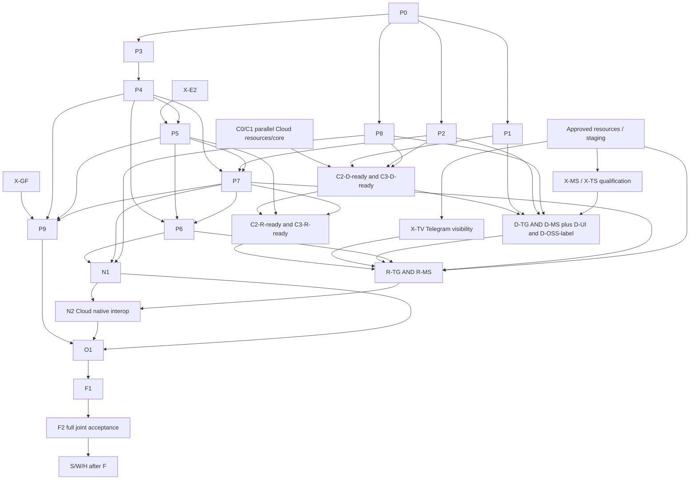

# Human channels: OSS build tasks and integration gates

Status: build-plan proposal for aweb-acft.11; implementation has not started.
Canonical shared plan: [Cloud build plan](https://github.com/awebai/ac/blob/main/docs/human-channels-build-plan.md)
(prepared in parallel; the review handoff pins its exact SHA). That document owns
C, both platform adapters, resources and the overall graph. This sibling owns
P, N1, O1 and F1. Task IDs below are shared with the Cloud author.

## Decision record and fixed scope

**Section 10: decided: as recommended (Juan, 2026-10-20).** This records J1–J9
in Cloud's design; its section 10 is marked in the Cloud plan commit, not the
reviewed design landing. OSS design landed on main at
`b423415a92bf1a43d023e0dddc962036266d831a`, byte-identical to reviewed `ae11d394`;
Cloud reports its reviewed design landed at `112caddf`.

Implement B+ typed bridge-attested session participants, pairwise/session-scoped
guest subjects, approved whole-platform-room audience and join-forward message
history, any authorized identity's dedicated presence, and platform-wide native
suppression initially. Scoped native transport remains a designed option needing
explicit approval. Recover eligible history without a silent 24-hour cutoff;
count one logical message once. Teams capability gaps are qualified and surfaced,
not silently cut. Telegram and Teams both reach F before S/W/H (Slack, WhatsApp,
chasing), per J7. Org/resource policy and explicit human consent govern delivery.
J9 chooses consented full control history/counters: people learn who was present
before their join and who was removed; message IDs/envelope hashes/content remain
interval-bound. The join-snapshot alternative is not an implementation task under
this decision; choosing it later requires the separately costed proof design.

Governing contract: [human-channels proposal](human-channels-contract-proposal.md),
especially typed assurance, native `via`, alias first contact, signed membership,
control/message history, export checkpoints and unknown-outcome recovery.
Existing [identity/messaging](identity-messaging-contract.md),
[E2EE](e2e-messaging-contract.md), [attachments](attachments.md),
[receipt/runtime behavior](receiving-events.md) and
[OSS boundary](oss-boundary.md) remain binding. Native keys stay with their actual
custodians; a room is an existing chat session. Guests gain no team/admin rights.

## Task conventions and seam

Paths below are relative to **aweb** unless marked **ac**. New files are proposed
module boundaries, not claims that the feature exists. Each P task has a single
reviewable result; where consumers can be staffed separately, child IDs make
that boundary explicit. Staff entries name durable souls, not current instances.
The coordinator assigns instances; this plan creates none.

Migration names `M-P3`, etc. identify work packages, not reserved SQL numbers.
Allocate the next ordered migration when implementing, never edit an existing
migration. Each includes old-data backfill, constraints/indexes and an upgrade
journey from a populated old database. Preserve existing accepted native shapes;
legacy unknown export capture never becomes eligible through backfill.

Cloud owns `ChannelAdapter` (C0): both Telegram and Teams implement
`verify_and_extract -> VerifiedEvent`, link/account proof UX, exact-resource
`prove_room_authority`, inspect/claim/disconnect intake, qualified capabilities
and `render/send -> accepted|rate_limited|forbidden|too_large|transient_not_sent|unknown`.
`VerifiedEvent` carries private subject/scope/event/time/kind/reply/thread evidence;
it means authenticated platform intake, not native-human signature assurance.
The common core produces an ordinary signed aweb message/typed session operation.
Platform IDs, credentials and webhook logic stay in ac. OSS runtime consumers
receive generic chat identity, verification, provenance, control policy and
receipts; they do not import Telegram/Teams SDKs. C0 fixes exact method/DTO names
in the canonical plan, with P0 agreeing the public request/result boundary.
Adapter tests may use controlled fixtures, but D/R/F acceptance uses real providers.

**Attachment seam (C0/O4, private, not a new wire descriptor):** both adapters
extract `ChannelAttachment = {ref, filename, media_type, declared_size?,
declared_sha256?, expires_at?}`. The opaque ref is bound to the authenticated
`VerifiedEvent`, subject and connection; it is never a public URL or credential.
`ChannelAdapter.fetch_attachment(ref, verified_event, limits)` supplies an
authenticated streamed byte result with sanitized errors. Provider authentication,
redirect/origin checks and SDK handling stay inside the adapter; the common core
never sees provider-specific fetch logic, URLs or credentials.

The core reserves quota, enforces actual streamed byte/count limits regardless of
declarations, validates MIME/name/content and any declared digest, computes final
length/SHA256, and stages under the existing managed acfn provider. Only acfn's
normal immutable descriptor enters the signed public message. Apply the lowest
of current attachment capabilities, adapter and owner-policy limits: baseline
5 MiB/file, 4 files/20 MiB per send, 100 MiB/user/day and 200 MiB/team; retain
existing allowed types, staging/expiry and reservation controls. Failed fetch or
validation produces no authored-message signature, message, wake or logical-send
charge; existing upload reservation/rate/byte accounting still applies. O4/O1
exercise both real adapters through this same core: wrong subject/ref,
expired/unavailable bytes, oversized declarations and streaming overflow, digest
mismatch, quota/concurrency races and matching real byte transfer. No new OSS
file store, schema or platform-specific public capability is added.

P0 fixes versioned API/byte/vector, consumer-facing DTOs and the supported
embedded transaction/idempotency facade implemented by P2b. Spike-dependent re-share/federation annexes are frozen
after X-E2/X-GF and Athena review at each exact annex SHA, as for P0, before
their implementation tasks; native P1/P2 work does not
wait for an unrelated risky annex. C resources,
credential custody, linking and adapter qualification start before P0 finishes;
they must not invent a second public wire shape or private insert hook. Their
first public send/checkpoint integration waits for P0 and the implementing P task.

## P — public protocol and consumers

### P0 — freeze the implementable contract profiles and vectors

- **Repo/files:** aweb `docs/human-channels-contract-proposal.md`,
  `docs/identity-messaging-contract.md`, `docs/e2e-messaging-contract.md`,
  `docs/receiving-events.md`; root `docs/vectors/human-channels-*.json` profiles (current public vector authority).
- **Migrations:** none. Establish M-P3/M-P4/M-P5/M-P7/M-P9 ownership/order.
- **Dependencies:** decided design; C0 agreement on request/result/capability DTOs.
- **Result:** precise native via, typed-chat/group context, membership/control
  chain, history grants, guest trust, presence intent, native receipt and checkpoint
  grammar/version negotiation; positive/tamper/legacy/unsupported vectors. Preserve
  original signed bytes and existing native-v2 header/AAD behavior.
- **Acceptance/live journey:** Go/Python/TypeScript consumers agree on canonical
  bytes and refusals; old native fixtures still verify. A real released `aw`
  sends/reads with a real local server while a new consumer exercises the new
  profile; incapable consumers never see a guest as a verified native author.
  This local journey needs no Telegram/Teams credential.
- **Staff:** `aweb-protocol-expert`; independent protocol reviewer, Athena for
  identity/E2EE correctness. This is the contract gate before feature emission.
- **Embedding seam:** specify a public prepared-send/unit-of-work API, not
  private messaging-table writes. Verify/prepare outside the transaction, then
  recheck authority and accept the exact envelope with the caller's shared
  transaction, message ID and idempotency key. An embedding can commit its own
  ingress result in that same unit of work; message/receipt/result and durable
  mutation outbox commit or roll back together. Events publish only after commit.
  No Cloud-specific callback is inserted into the message write. A remote HTTP
  consumer instead uses durable ingress intent + stable message ID/public
  acceptance lookup and retry; it cannot claim a cross-database transaction.

### P1 — optional signed channel provenance on native mail and chat

- **Repo/files:** aweb `cli/go/awid/{signing,e2ee_messages,mail,chat}.go`,
  `server/src/aweb/{e2ee_messages.py,routes/messages.py,routes/chat.py}`,
  `channel-core/src/identity/`; conformance readers and compose/read tests.
- **Migrations:** none expected: retain signed payload/inner content as source.
  Any necessary persisted projection uses a new ordered migration, never a
  required legacy wire field.
- **Dependencies:** P0 native-via profile. Independent of typed guest storage.
- **Acceptance/live journey:** plaintext and encrypted-v2 mail/chat preserve
  `telegram`/`msteams` through compose, verify/decrypt and JSON read; changing via
  breaks protection, omission grants no authority, malformed input refuses with
  no plaintext retry. Old/new clients exchange native messages on real servers.
- **Staff:** `aweb-protocol-expert`. C/D consume this before channel emission.

### P2 — native direct addressing and prepared-send integration

- **P2a repo/files:** aweb `cli/go/cmd/aw/{helpers,mail,chat}.go`,
  `cli/go/awid/{client,mail,e2ee_keys,registry_resolver}.go`,
  `server/src/aweb/messaging/{chat,messages}.py`, messaging HTTP/MCP routes and
  participant-key discovery; existing human/alias parity tests.
- **P2b repo/files:** aweb `server/src/aweb/messaging/{messages,chat}.py`, a
  new public embedding/unit-of-work module and HTTP/MCP acceptance callers.
  Implement the P0 prepared-send/idempotency facade for native mail/chat, ready
  for P7 to add group checkpoint/capture in the same acceptance boundary.
- **Migrations:** P2a none expected; P2b adds an ordered durable result/idempotency
  or publication-outbox migration only if current receipt/outbox storage lacks
  the required result/transaction semantics; reuse existing ingress receipts.
- **Dependencies:** P0 selector/discovery and embedding contracts; actual
  custody/access proof. Children can be staffed separately and both gate D.
- **Acceptance/live journey:** real `aw mail send --to juan` in an explicitly
  selected team reaches that team's human actor; agent aliases still work.
  HTTP/MCP agree; duplicate labels across teams, inactive actors and conflicting
  bindings refuse. A valid identity-signed encryption assertion supports encrypted
  local first contact; absent/invalid assertion fails explicitly, never plaintext.
  Unknown external bare DID first contact still refuses. Hosted/BYOT/local cases
  distinguish actual custody from team-controller authority.
- **P2b acceptance/live journey:** real PostgreSQL embedding commits actor send
  plus provider-owned ingress result once; inject failure on either write and
  observe neither message nor result nor wake/charge. Retry exact bytes returns
  the original result; conflicting bytes refuse. Commit then crash before event
  publication recovers through the durable outbox with no duplicate message.
  Cloud C2/C3 readiness implements this supported API; D supplies its joint live
  DM acceptance, with no privileged table/insert hook. HTTP mode is tested as idempotent recovery, not distributed
  atomicity. No fake `aw` or fake database proves the integration.
- **Staff:** `aweb-protocol-expert`. No new global human address.

### P3 — typed session-participant storage and authorization identity

- **Repo/files:** aweb `server/src/aweb/messaging/{chat,conversations}.py`,
  `identity_metadata.py`, chat/conversation models and public participant lookup;
  `cli/go/awid/chat.go` DTOs; new participant-reference module/tests.
- **Migrations:** M-P3 adds tagged native/bridged participant references and
  exact bridge/subject/context uniqueness; backfills native DID rows without
  changing their meaning. Keep native indexes/accepted lookups compatible.
- **Dependencies:** P0. Private platform-account mapping stays in C.
- **Acceptance/live journey:** two same-name guests have separate ACLs/routes;
  one pairwise subject is stable across intake bots within its session, with
  no automatic cross-session association. A guest has no agent/team/admin entry.
  Public participant DTO/verifier tests distinguish native signer verification
  from external/untrusted author assurance; wrong bridge/subject/context refuses.
  Key-loss tests create new subjects without reassigning or merging old guests;
  old history/contact continuity is unavailable until explicitly re-associated.
  Live guest create/list acceptance waits for the P5 activation gate below.
- **Staff:** `aweb-protocol-expert`. This is storage/identity foundation, not yet
  permission to enable guest traffic before P4/P5/P6.

### P4 — signed group membership, admission consent and owner succession

- **Repo/files:** aweb `server/src/aweb/{routes/chat.py,messaging/chat.py}`,
  new group-policy/participant-operation verifier, `cli/go/awid/chat.go`, root
  membership vectors and HTTP/MCP/group authorization tests.
- **Migrations:** M-P4 stores signed creation/policy records, linked heads/epochs,
  delegated management, admission/removal intervals, consent and owner transfer;
  existing `left_at` becomes enforced state, not a substitute turn-end flag.
- **Dependencies:** P0/P3; public identity/key/controller boundaries unchanged.
- **Acceptance/live journey:** signed-chain verifier and storage tests cover
  three-plus native/guest participants joining, leaving and rejoining; the public
  positive new-mode journey runs only after P5 activation. Inbound policy blocks
  a refusing cross-team or federated recipient before any message/wake/wrap. All senders verify the
  chain before wrapping; injected server-only adds cannot alter an E2EE group.
  Valid consenting owner transfer continues; absent/revoked owner freezes, while
  a narrow-only export stop remains possible. `sender_leaving` ends only a turn.
  Forked chains (two heads at one epoch), replayed older policy, a non-owner add
  without valid delegation and stale-epoch adds each refuse before any wrap or
  wake. A real public encrypted-session bridge admission without either the
  required disclosure consent or bridge-readable label refuses with no effects.
- **Activation gate (A1, gating rather than moving P5):** P4 may land storage and
  verifiers, but new-mode membership remains unadvertised and refused by servers
  and published consumers until P5's J9 control-history consent and whole-session
  bridge-readable label have landed with compatible consumers. No early P4
  feature artifact advertises admission. P5 depends on implemented P4, not its
  activation; P5 then unlocks the integrated positive admission journey. Existing
  accepted native sessions remain readable; this does not narrow old wire shapes.
- **Staff:** `aweb-protocol-expert`.

### P5 — interval message history, disclosed controls and encrypted re-share

- **Repo/files:** aweb chat/conversation pending/history/read/SSE authorization,
  `routes/chat.py`, `messaging/chat.py`, attachment authorization,
  `cli/go/awid/e2ee_messages.go`, `server/src/aweb/e2ee_messages.py`,
  `docs/e2e-messaging-contract.md`; membership/history/cross-language vectors;
  minimal CLI/channel-core/channel/pi/Hermes disclosure/label and refusal support
  required for safe admission, separate from P6 full group interaction.
- **Migrations:** M-P5 persists history grants/rejoin intervals, disclosure consent
  and explicit re-share records; no automatic historical wraps/backfill export.
- **Dependencies:** P4 and X-E2 before committing the re-share profile.
- **Acceptance/live journey:** join-forward and removal gaps deny message IDs,
  hashes, receipts/body/files across all direct/list/cache/cursor paths. Explicit
  consent exposes full old membership/control history and counter 101 without
  stripping signatures; removal denies future control state. Four real local
  clients demonstrate future wraps excluding removed keys and authorized old
  content re-share without rewriting its original author's signature. Bridge
  membership labels the entire session not E2EE and includes its wrap on every
  message; unknown keys/capabilities never cause plaintext fallback. P5 releases
  the P4 activation gate only when both disclosures/consent and compatible client
  labels are available. Repeat P4's positive public join/remove/rejoin journey and
  its missing-consent/missing-label refusals against the released feature artifacts.
  P5 includes the minimum client label/consent enforcement; activation does not
  depend on completing P6 full group interaction, which follows P5/P7.
- **Staff:** `aweb-protocol-expert`. Full control-history mode is the decided
  implementation; do not quietly substitute the unselected snapshot alternative.

### P6 — group CLI, MCP and runtime projections (three bounded child tasks)

- **P6a repo/files:** aweb `cli/go/{chat/chat.go,awid/chat.go,cmd/aw/chat.go}` and
  `server/src/aweb/mcp/tools/chat.py`; additive create recipient lists, membership
  operations, exact session send/history selectors and public receipts.
- **P6b repo/files:** aweb `channel-core/`, `channel/`, `pi-extension/` and
  `cli/go/cmd/aw/wake*`; generic typed-author/via/session/control metadata and
  participant-authorized local readback, capability handling and receipt cursor.
- **P6c repo/files:** aweb `packages/hermes-aweb-platform/adapter.py`, its tests
  and package docs; group participant context/reply/readback/assurance. Native
  transport ownership/effects are N1, not implemented by inventing a sender here.
- **Migrations:** no server migration; version any changed local receipt/store
  format additively, preserving pending native state. Explicitly list one if a
  child actually changes a durable local schema.
- **Dependencies:** all children P0; group completion P4/P5/P7; provenance P1.
- **Acceptance/live journey:** each child uses a real server and supported runtime
  to receive a guest as external/untrusted, a linked native actor as verified,
  and intact signed via. Reply targets the exact session and does not leave it
  unintentionally. Restart/readback preserves assurance, disclosure and receipts.
  Old native pair/group paths still work. P6 completes only when all three pass.
- **Staff:** separate `aweb-protocol-expert` instances may implement children in
  parallel; one shared DTO/vector contract, not three competing author models.

### P7 — public checkpoint, atomic capture and bounded recovery reads

- **Repo/files:** aweb `routes/chat.py`, shared messaging acceptance/transaction
  path, policy verifier and new checkpoint/acceptance service; federation receipt
  integration, HTTP/MCP APIs, CLI DTO/read support and root checkpoint vectors.
- **Migrations:** M-P7 adds transactional session acceptance order, checkpoints,
  immutable message capture and transition/replay tombstones. Backfill old rows
  only as `legacy_unknown`; never infer eligibility from later settings/time.
- **Dependencies:** P0/P4 and P2b acceptance facade; P5 for control-versus-message
  read authorization. Group capture extends the same supported public unit of work.
- **Acceptance/live journey:** a send started before a checkpoint but committed
  after it revalidates/recomposes; no wrong-audience capture. Real concurrent
  clients cover commit/rollback, exact/conflicting retries, lost response before
  private activation, paginated late commits and history/control grants. An admitted
  bridge/independent revoker stops only its own stream with owner unavailable and
  no read grant; it cannot activate/widen. Historical eligible capture never
  overrides current revoke; old native APIs/bytes remain accepted. Unauthorized
  non-owner activation/widening, stale-checkpoint CAS and attempts to execute or
  reactivate a tombstoned transition refuse. Authorized narrow-only own-stream
  stops remain allowed; an exact authorized retry/read may recover the original
  receipt without executing it again. No checkpoint-bound capture receipt may be
  minted for a message committed outside that checkpoint's acceptance range;
  concurrent boundary tests verify its sequence, generation and range.
- **Staff:** `aweb-protocol-expert`. C binds private state only through these
  public results; no hosted callback inserted into message persistence.

### P8 — portable identity/owner presence-intent verification

- **Repo/files:** aweb Go/Python public identity-signing/verification libraries,
  new presence-intent DTO/verifier and root vectors; CLI signing helper as needed.
  C owns registration endpoints/settings, bot tokens and generation persistence.
- **Migrations:** none in OSS; C's presence lifecycle migration owns persistent
  settings. No global presence registry or native agent key custody is added.
- **Dependencies:** P0, actual native identity/verified ownership authority.
- **Acceptance/live journey:** hosted, local and self-custodial/BYOT keys authorize
  their own platform-wide native registration; verified owner lane is distinct.
  Wrong owner/team/admin, stale generation/replay/audience and mail-only grants
  cannot suppress another actor. Native downtime remains visible non-delivery,
  never shared-bot fallback. C verifies a real signed request without the key.
- **Staff:** `aweb-protocol-expert`; C presence implementation `aweb-cloud-expert`.

### P9 — authoritative group federation (two bounded child tasks)

- **P9a repo/files:** aweb `server/src/aweb/federation/`, `routes/federation.py`,
  chat session creation/join and policy-proof synchronization. Preserve current
  1:1 refusal/accepted paths until group capability is negotiated.
- **P9b repo/files:** same federation delivery/receipt/outbox modules and chat
  continuation; per-peer fanout/replay and local eligible-participant dispatch.
- **Migrations:** M-P9a session-peer/policy checkpoint state; M-P9b durable peer
  fanout intents/receipts. Respect existing global ingress message-ID identity.
- **Dependencies:** X-GF, P4/P5/P7; P9b follows P9a. P6 consumes the same public
  session handle, never reconstructed pair copies.
- **Acceptance/live journey:** three real services/registries, mixed local/remote
  native and bridge participants, one preserved signed message and acceptance
  capture, partial peer failure/retry, conflicting UUID, concurrent removal and
  unavailable authority. No duplicate message/wake/contact effects, no unsigned
  membership route or hidden participant list. Pair federation remains green.
- **Staff:** `aweb-protocol-expert`; one independent reviewer plus Athena on
  the protocol/security delta. P9 completes only after both children.

## Bounded spikes before committing risky implementation

The timeboxes below are proposed staffing caps, not claims of completed work.
Each ends in a concrete go/no-go artifact or a specific contract question; an
inconclusive spike blocks its dependent task, never authorizes a shortcut.
Freezing X-E2/X-GF contract annexes requires Athena review at the exact result
SHA, just like P0. No spike may weaken consent, signature checks, explicit
encryption, chain-verify-before-wrap, owner transfer/freeze, narrow-only stop,
checkpoint commit order or inbound policy. An X-GF outcome that makes the owner
chain advisory is refused.

| ID / staffing cap | Repo/modules and migrations | Dependencies / real resources | Exit evidence, acceptance and staffing |
| --- | --- | --- | --- |
| X-E2 / 1 working day | aweb E2EE contract, Go/Python envelope/keys and vectors; migration none in spike | Decided history model; real local clients/server/keys, no platform account | Prototype one authorized historical re-share to a newcomer, preserving original signed bytes/proof and publishing a separately signed transfer/re-share. Demonstrate removed key gets no future wrap, tamper/no-key refusal and no plaintext retry. Choose the implementable artifact/key-authority model for P0/P5 before coding it; do not assume re-wrapping mutates a valid old signature. Staff `aweb-protocol-expert`. |
| X-GF / 2 working days | aweb federation/chat policy/acceptance topology and vectors; no persistent migration in spike | Existing real local multi-service/AWID harness; proposed P0 profile | Three-service trace: creation/consent, owner chain, message/capture and peer receipt/retry/removal; resolve who serializes and how replica recovery verifies authority. Document bounded failure/partition behavior and concrete P9 schema/API needs. An advisory owner chain is a no-go outcome. No pairwise-envelope UUID reuse or exactly-once tool claim. Staff `aweb-protocol-expert`. |
| X-MS / 1 working day | ac adapter/SDK proof module; migration none | F0 Azure bot/app plus M365 customer test tenants/installation, approved credentials | Cloud-owned: prove Agents SDK fit with Connector validation, personal/group/channel receive/send and dedicated/shared identities through C0. Installation/tenant/credential failures are evidence, not a mocked success. End with a supported package/version/config choice or precise blocker. Staff `aweb-cloud-expert`, resource setup `aweb-cloud-operations-expert`. |
| X-TS / 1 working day | ac adapter normalization/activation fence tests; migration none | F0 real Telegram + Teams events with preserved provider timestamp evidence | Cloud-owned: classify original/edit/callback/retry timestamps, precision and replay/delay behavior; prove no pre-activation event becomes a human signature. Unsupported kinds refuse, callbacks cannot borrow an old bot-message time. No claim that timestamps defeat a compromised account. Staff `aweb-cloud-expert`. |

Cloud's canonical plan owns exact X-MS/X-TS files and outcomes; these rows pin the
cross-repository gates, not a second SDK/platform implementation.

**X-TV — Telegram visibility qualification (Cloud-owned, separate from X-TS).**
Before R-TG can pass, qualify the actual privacy/admin configuration, receiving
Bot-to-Bot Mode plus (admin rights OR privacy disabled), and private exchange with
both bots' modes enabled. Real basic-group, supergroup and topic journeys prove
ordinary unmentioned human messages, bot-origin messages and topic isolation;
missing all-message visibility visibly blocks the requested room mode. Evidence
pins settings/API capability and one intake owner where cross-bot IDs are not
shared. This uses the F0 Telegram resources above and `aweb-cloud-expert`; no OSS
schema or provider-specific core code. Timestamp qualification cannot satisfy it.

## D / R integration and N / O / F OSS tasks

| Task | Repo and files/modules | Migrations | Dependencies | Behaviour tests and live journey | Soul |
| --- | --- | --- | --- | --- | --- |
| D-OSS — native direct-message contract integration | aweb server HTTP/MCP mail/chat tests, Go CLI/custody tests and public vectors | None beyond P tasks | P1/P2/P8, C0/C1 and C2-D-ready/C3-D-ready public integration readiness, D-UI | Real CLI first-contacts a linked human alias; two accounts/teams, exact reply binding, via and native suppression work; unknown bare DID/unlinked unsolicited guest DM refuses. Behavior tests and real two-account/provider journeys prove cross-user replies, privilege commands and stale lifecycle events yield no human signature, message, wake or usage effect. Unlinked/unpaired DMs through each adapter share one core refusal: no aweb message, wake, charge, stored body or agent-visible raw ID, only the pairing reply. D-TG and D-MS consume the same path; both platform journeys required, neither substitutes for the other. | `aweb-protocol-expert`; paired Cloud D owners `aweb-cloud-expert` |
| D-OSS-label — sender confidentiality disclosure | aweb Go CLI send/read/receipt rendering, channel-core/channel/pi/Hermes send-result projections and assurance tests; Cloud D-UI owns dashboard label | None | P0/P1/P2, compatible public custody/bridge evidence; C-ready, tested jointly in D | Sender sees **“not E2EE”** for a linked-human DM through bridge or hosted custody, including encrypted-v2 to a hosted key. Authorship verification stays unchanged; via alone never establishes custody. Real CLI/runtime and D-UI journey on both providers checks label before/after send and readback; genuine native self-custodial encrypted pair remains the valid E2EE neighbor. These direct-message projections do not wait for group P6 or R-UI; D completes only with this task and D-UI. | `aweb-protocol-expert`, Cloud D-UI `frontend-developer` |
| R-OSS — public session and route integration | aweb group API/CLI/MCP/read/receipt and attachment tests | None beyond P3–P7 | P3/P4/P5/P6/P7, C2-R-ready/C3-R-ready and both qualified full-room adapters (TG X-TV, Teams X-MS) | Two agents, linked and unlinked humans in one session; same author/session message across bots, membership/control consent, owner transfer/freeze, old message exclusion and whole-session bridge-readable status. A real guest-map key-loss/restart journey yields new session subjects, never silently inherits old guest history/contact authority, and permits continuity only by explicit authorized association. R-TG group/topic and R-MS chat/channel thread pass against the same C0 core; group federation joins after P9, not emulated with DMs. | `aweb-protocol-expert`, Cloud R owners `aweb-cloud-expert`, dashboard `frontend-developer` |
| N1 — durable native input/output interop | aweb generic native-chat receipt API/library, channel-core delivery/operation store, CLI/wake and packages/hermes-aweb-platform; upstream NousResearch/hermes-agent plugins/platforms/telegram/adapter.py and gateway processing callbacks if the receipt interface needs an upstream patch | Versioned local operation/effect/reply ledger; any server claim/receipt table gets a new ordered migration | P0/P6/P7/P8; N2 implements private correlation; P9 before remote-native acceptance | Real native Hermes owns a turn while bridge/shared/dedicated peers observe it; one fenced input owner, original signed native output, no guest echo. Real fresh-ID bot-loop journeys hit bounded per-session/agent rate/turn budgets and a circuit breaker with visible stop and owner-authorized reset; dedup alone cannot pass. Crash before start, after an external effect before receipt, after reply commit and during send: reconcile or visibly block unknown outcomes; never blindly reexecute or silently fall back when native is down. Any upstream module needed is a named dependency, not assumed shipped by OSS registration. | `aweb-protocol-expert`; Cloud N2 `aweb-cloud-expert` |
| O1 — public recovery, revocation and file boundary | aweb receipt/policy/history/replay API tests, attachments contract/authorization tests and real CLI recovery driver | None beyond P5/P7/P9/N1; retain receipt/revocation tombstones | P5/P7/P9/N1, Cloud O2/O3/O4 | Drop hints, delay commit, restart and page after long outage; no eligible message skipped and no old audience inferred. Revoke bridge independently: fresh old-key guest event and unsent exports refuse; incomplete scopes show blocked. Test managed files through the shared attachment descriptor/authenticated byte-fetch seam by real byte transfer, interval/quota/expiry authorization and replay, not a bearer URL. O3 live acceptance includes authenticated requester-only settings/routes export and erasure of caches, pending payloads and backups by the existing retention deadline; G-ERASURE-DEADLINE blocks O3/F2 until operations proves an existing cache/pending/backup erasure deadline or Juan chooses one. Attachment expiry (30d/24h) alone does not establish that deadline. | `aweb-protocol-expert`; hosted lifecycle/files/dispatch stay with `aweb-cloud-expert` |
| F1 — public/released-consumer acceptance | aweb real CLI/server/AWID multi-service harness, package install/run paths and sanitized evidence under docs/evidence; release metadata only under normal coordinator flow | None; demonstrate ordered upgrades from old populated schema | P0–P9, D-OSS/R-OSS/N1/O1, N2/O2–O4 and F0; F2 combines both platforms | Run published old/new CLI, Claude channel, pi and Hermes consumers against real services; exercise local/global/self-custodial/custodial identities, grant constraints, encryption, full room membership/federation, receipts and no duplicate effects. F2 additionally proves all shared/dedicated/native presences on both real platforms, two orgs and dashboard completeness. No fake aw/provider satisfies this gate. | `aweb-protocol-expert`; F2 `aweb-cloud-expert`; staging/resources `aweb-cloud-operations-expert` |

N1 is not completed by an upstream adapter assumption. Its first implementation
subtask pins the native runtime repository/version and the Telegram adapter/
processing callback paths, using [current Hermes evidence](hermes-aweb-live-findings.md)
as a starting point rather than assuming it already supports correlation. Its
next subtask supplies the specific receipt/proof patch and crash journey; any
upstream landing/version is an explicit F dependency. N2 also needs a separately
operated real Teams native bot/reference adapter; a Telegram-only Hermes result
does not prove native Teams. Staff the upstream patch with
`aweb-protocol-expert` and its upstream owner; Cloud owns the Teams reference
transport through C0/N2. Neither is inferred from registration UI.

## Dependency graph, parallel work and critical path

Day one: P0, C resource/link/credential work, all four bounded spikes and F0
resource provisioning run in parallel. They have separate stores/modules;
identity/API integration joins at the named P gates. P1/P2/P3/P8 can then be
staffed concurrently. P6 children run in parallel once their shared DTOs and
public authorization semantics exist. Do not run competing migrations without
coordinating their ordered numbers.

The public critical path is P0 → P3 → P4 → P5 → P7 → P6/N1 and P9 → O1/F1 → F2.
X-E2 gates P5; X-GF gates P9. In parallel, C0–C3 plus X-MS/X-TS/resources gate the
paired D and R journeys and N2. C2/C3 readiness is implementation plus core
behavior/integration tests against supported P APIs, with separate direct and
room milestones. Neither readiness milestone requires a completed D/R live
journey: D joins C-D-ready with both adapters and D-UI; R joins C-R-ready with
both room adapters and R-UI. Their live acceptance belongs to D/R/F, not a
prerequisite back into C. X-TV separately gates R-TG visibility; X-TS qualifies
only timestamps. The slower public or platform/resource branch
controls F2; a credential/tenant/SDK blocker can therefore dominate the schedule.
D can prove direct journeys while group work continues, but is not the full
product finish. Group federation stays in F; no implicit ordering decision drops
it. The canonical Cloud graph additionally names O2/O3/O4 and exact C gates.

## Resources and exact blocking points

| Resource package (F0 owns provision/access evidence) | First blocker | Work that can proceed without it |
| --- | --- | --- |
| Local disposable PostgreSQL/Redis, three aweb services/AWID registries, real built/published aw and native keys | P0 old/new journey, P3–P7 database/HTTP proof, X-E2/X-GF and P9 real topology | Contract/vector drafting, C storage code and adapter fixture tests |
| Approved Telegram shared bot, two dedicated identity bots, a separately owned native Hermes bot; linked + unlinked test humans, private chats, basic group and supergroup/topic | X-TS timestamp and X-TV visibility proof; D-TG/R-TG/N2/F2 real journeys. Do not use a native bot's token for Cloud intake | Generic P/C work and Teams qualification |
| Approved Azure bot/Entra app resources, shared/dedicated and a separately operated native bot/app identity, M365 customer test tenants and admins/users; personal/group/team/channel installations | X-MS and X-TS Teams proof; D-MS/R-MS/N2/F2 real journeys. Missing tenant/install/room capability is a hard live gate | Generic P/C work and Telegram qualification |
| Approved staging with managed custody/key storage, dashboard, public OSS package versions and cleanup permission | C custody proof, joint D/R/N/O live journeys and F2; private actor signing must be real | Local public protocol/schema work and bounded local spikes |
| Real Claude/Codex/pi/Hermes seats and any required model access, with the native adapter/version qualified | P6 runtime proof, N1/N2 and F1/F2 model-driven journeys | Server/CLI behavior tests and deterministic operation-ledger crash tests |
| Slack workspace/install/admin, then official WhatsApp business/group capability and consented chase endpoints | S/W/H live tasks after F, per J7 | All F work; later adapters may be designed against C0 without claiming live support |

F0 records sanitized resource names/owners and permission scopes; credential
locations/access are supplied out of band, never secrets in git/mail. Resources are not created by this
plan. No production/customer/nactiva or commandodev work is authorized here;
operations supplies the approved staging/test targets. If a resource is absent,
mark the exact live gate blocked while continuing independent tasks above.

## After F and completion evidence

**H-OSS — signed advisory chase hint, after F2 only.** Repo aweb: native mail/chat
compose DTOs, Go signing/E2EE content helpers, CLI send options and root vectors;
migration none expected. Dependencies: F2, P0's reserved hint shape and Cloud H's
human-consent/quiet-hour/default-off policy. `aweb-protocol-expert` freezes and
implements the platform-kind-only hint with old/new compatibility. Real CLI/server
journey preserves it through plaintext or verified decrypt; it never selects an
account, overrides consent or causes a second authored message/charge. An unreadable
encrypted hint stays unavailable, never triggers decryption/plaintext fallback.
Cloud H then proves the permitted additional attempt on approved real endpoints.
This is a distinct post-F task, not early chase activation hidden in P1.

Canonical S/W/H tasks reuse C0 and all public message/session/identity contracts.
They implement Slack rooms/threads and installation scopes, officially qualified
WhatsApp operation and consent-bound signed platform-only chase hints. They need
their own real resources and bounded provider-capability qualification; absence
of official capability proof is surfaced to Juan, never filled by an unofficial
client or a claim that a renamed shared message is a dedicated identity.

Each task handoff is its exact SHA, bounded diff, relevant behavior result and
remaining live-resource dependency. One independent reviewer reads each change;
Athena reviews protocol/E2EE/security parts. The covering gate passes before each
landing. Whole suites obey the existing shared-machine suite lock; do not rerun
unrelated suites to manufacture receipts. Implementation identity-path changes
record Juan's required authority separately; this design/build-plan decision is
not a production credential grant or blanket permission to alter identity paths.
F1/F2 evidence pins actual artifacts/runtime/provider versions and sanitized
journeys, including failures next to valid neighbors, without secrets. No task
is complete solely because a mock/fixture or one of the two platforms passed.
